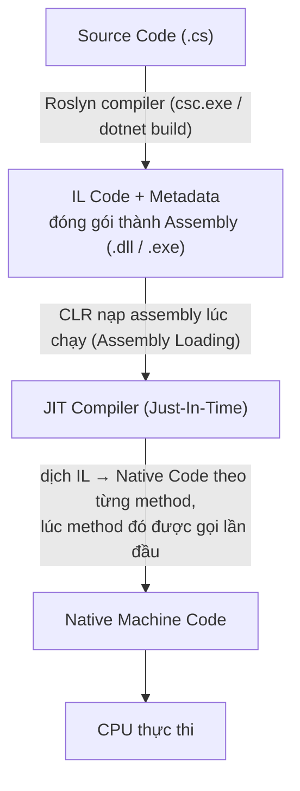
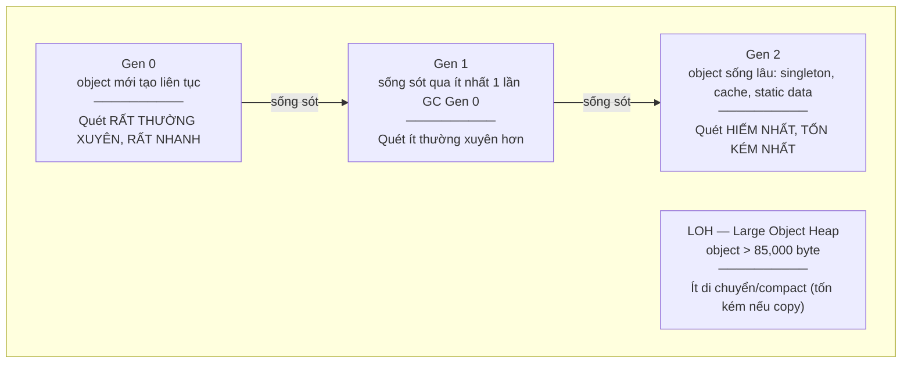

# 01 — Vùng nhớ & Runtime: Nền móng thật sự của C#

> Lưu ý thuật ngữ: "Stack" và "Heap" ở đây là **vùng nhớ** (memory region), khác với `Stack<T>` / `Queue<T>` là **cấu trúc dữ liệu** (data structure, nói ở file [02](02-OOP-And-Language-Features.md)). Hai khái niệm trùng tên nhưng không liên quan gì nhau — đây là nhầm lẫn rất phổ biến.

---

## 1. Từ source code đến lúc chạy

### 🧠 Ví dụ trước

Bạn viết:

```csharp
int Sum(int a, int b) => a + b;
```

Bấm F5 chạy. Nhưng giữa lúc gõ code và lúc CPU thực sự cộng hai số, có **3 giai đoạn biến đổi** mà hầu hết người code chỉ biết tồn tại chứ chưa thấy rõ hình hài.

### 📌 Bản chất



- **Roslyn** (compiler của C#) không dịch thẳng ra mã máy. Nó dịch ra **IL** — một ngôn ngữ trung gian giống assembly nhưng độc lập phần cứng. Đây là lý do một file `.dll` build trên Windows chạy được trên Linux/macOS (miễn có .NET runtime tương ứng).
- **CLR** (Common Language Runtime) là "cỗ máy" chạy chương trình .NET: nó nạp assembly, quản lý bộ nhớ (GC), kiểm tra type an toàn, xử lý exception...
- **JIT** chỉ dịch method ra native code **khi method đó được gọi lần đầu tiên**, rồi cache lại native code đó để lần gọi sau dùng luôn (không dịch lại). Đây là lý do request đầu tiên của một ứng dụng ASP.NET Core thường chậm hơn các request sau ("cold start").

> ✅ Có một dạng build khác tên **AOT (Ahead-Of-Time)** — dịch thẳng ra native code ngay lúc build, bỏ qua JIT lúc chạy. .NET hiện đại hỗ trợ Native AOT để khởi động nhanh hơn, hay dùng cho container/serverless. Bản chất pipeline vẫn vậy, chỉ là bước JIT được dời lên lúc build.

Xem thử IL bằng mắt: cài `ilspycmd` hoặc dùng [sharplab.io](https://sharplab.io) — gõ code C#, chọn "IL", bạn sẽ thấy `int Sum(int a, int b)` biến thành các lệnh như `ldarg.0`, `ldarg.1`, `add`, `ret`. Nhìn qua một lần sẽ giúp bạn hết cảm giác "code C# là phép màu".

---

## 2. Stack và Heap — hai vùng nhớ

### 🧠 Ví dụ trước

```csharp
void Method()
{
    int x = 5;                  // (1)
    Person p = new Person();    // (2)
    p.Age = 30;
}
```

Dòng (1) và (2) đều là "tạo biến", nhưng chúng nằm ở **hai nơi khác nhau** trong RAM. Hiểu rõ chỗ nào là chìa khóa để hiểu tại sao có lỗi `StackOverflowException`, tại sao GC tồn tại, và tại sao truyền `struct` vs `class` vào hàm lại khác nhau.

### 📌 Bản chất

**Stack (ngăn xếp)** — vùng nhớ cấp phát cho **mỗi thread**, có kích thước cố định (mặc định ~1MB trên .NET), hoạt động theo nguyên tắc LIFO (vào sau ra trước):

- Mỗi khi gọi một method, CLR đẩy một **stack frame** mới lên: chứa tham số, biến local, địa chỉ trả về.
- Method kết thúc → stack frame bị "pop" ra, bộ nhớ coi như giải phóng ngay lập tức (không cần GC can thiệp). Đây là lý do biến local rất rẻ.
- Vì kích thước cố định, **đệ quy quá sâu** sẽ làm tràn stack → `StackOverflowException`. Đây là lỗi **không thể try/catch được** — .NET runtime kill process luôn, vì corrupt memory nguy hiểm hơn là catch rồi chạy tiếp.

```csharp
void Boom(int n)
{
    int[] local = new int[1000]; // mỗi lần gọi tốn thêm stack frame kha khá
    Boom(n + 1);                 // không có điều kiện dừng → StackOverflowException
}
```

**Heap (đống)** — vùng nhớ dùng chung cho cả process, không cố định kích thước (giới hạn bởi RAM), được **Garbage Collector (GC)** quản lý:

- Mọi `object` (được tạo bằng `new` cho reference type) nằm ở đây.
- Không tự giải phóng khi ra khỏi scope method — phải chờ GC xác định "không còn ai tham chiếu tới nó nữa" rồi mới dọn.
- Cấp phát lên heap "đắt" hơn stack: phải tìm chỗ trống, phải track để GC quét sau này.

### ⚠️ Hiểu lầm phổ biến cần sửa ngay

Rất nhiều tài liệu nói tắt: **"value type → Stack, reference type → Heap"**. Câu này **sai trong nhiều trường hợp** và là nguồn gốc của vô số hiểu nhầm. Quy tắc đúng là:

> **Vị trí lưu trữ phụ thuộc vào biến đó được khai báo Ở ĐÂU, không phụ thuộc type là value hay reference.**

| Tình huống | Value type (`struct`, `int`, `bool`...) | Reference type (`class`) |
|---|---|---|
| Biến local trong method | Nằm trên **Stack** | Biến chỉ là 1 con trỏ nằm trên Stack, **object thật nằm trên Heap** |
| Field của một `class` | Nằm **trên Heap**, nằm lồng bên trong object chứa nó | Nằm trên Heap (là 1 reference trỏ tới object khác trên Heap) |
| Phần tử trong mảng | Nếu mảng value type: dữ liệu nằm liền kề **trên Heap** cùng với mảng | Mảng chứa các con trỏ trên Heap, trỏ tới object khác trên Heap |
| Biến local trong method `async`/closure (lambda bắt biến ngoài) | Bị trình biên dịch "hoisted" lên Heap (đóng gói vào 1 class ẩn) dù khai báo là local | — |

```csharp
class Container
{
    public int Number;     // Number nằm TRÊN HEAP, vì nó là field của Container (class)
}

void Demo()
{
    int a = 10;             // a: Stack
    Container c = new Container(); // biến "c" (con trỏ): Stack. Object Container thật: Heap
    c.Number = 20;           // field Number: Heap (nằm trong object Container)
}
```

Vậy câu đúng nên là: **"Biến local value type nằm trên Stack. Mọi object (bất kể bên trong chứa field gì) đều nằm trên Heap."**

### 📌 Vì sao điều này quan trọng: Copy theo giá trị vs theo tham chiếu

```csharp
struct PointStruct { public int X; }
class PointClass  { public int X; }

void ModifyStruct(PointStruct p) { p.X = 999; }   // sửa trên 1 BẢN SAO
void ModifyClass(PointClass p)   { p.X = 999; }   // sửa trên CÙNG 1 OBJECT

var s = new PointStruct { X = 1 };
ModifyStruct(s);
Console.WriteLine(s.X); // 1 — KHÔNG đổi, vì struct được copy khi truyền vào hàm

var c = new PointClass { X = 1 };
ModifyClass(c);
Console.WriteLine(c.X); // 999 — đổi, vì class truyền con trỏ, cả 2 cùng trỏ 1 object
```

✅ **Khi nào dùng struct, khi nào dùng class:**
- Dùng `struct` cho dữ liệu nhỏ, bất biến về mặt ý nghĩa (như `Point`, `Money`, `DateTime`) — tránh cấp phát heap liên tục, tốt cho hiệu năng khi tạo nhiều instance (vòng lặp tính toán, game, xử lý dữ liệu lớn).
- Dùng `class` cho hầu hết business object — khi bạn cần identity (2 object khác nhau dù giá trị giống nhau), cần kế thừa, hoặc object khá lớn (copy struct lớn còn tốn hơn copy 1 con trỏ 8 byte).
- ⚠️ struct quá lớn (> 16 byte là mốc tham khảo) mà truyền đi truyền lại nhiều sẽ phản tác dụng vì chi phí copy, lúc đó class lại rẻ hơn.

---

## 3. Boxing & Unboxing

### 🧠 Ví dụ trước

```csharp
int number = 42;
object boxed = number;       // Boxing
int unboxed = (int)boxed;    // Unboxing
```

Nhìn vô hại, nhưng dòng `object boxed = number;` âm thầm **cấp phát một object mới trên Heap** để "bọc" giá trị value type lại — vì `object` là reference type, nó cần một chỗ trên heap để trỏ tới.

### 📌 Bản chất

- **Boxing**: copy giá trị value type vào một object mới trên Heap. Tốn: 1 lần cấp phát heap + 1 lần copy dữ liệu.
- **Unboxing**: copy ngược dữ liệu từ object trên Heap ra lại một biến value type trên Stack. Tốn: kiểm tra type (runtime check) + copy.

⚠️ **Lỗi thường gặp:** dùng các API cũ không generic (`ArrayList`, `Hashtable`, hay `string.Format("{0}", someInt)` phiên bản cũ) sẽ box ngầm mọi value type truyền vào, gây áp lực GC không cần thiết khi chạy trong vòng lặp lớn.

```csharp
ArrayList list = new ArrayList();
for (int i = 0; i < 1_000_000; i++)
    list.Add(i); // BOXING 1 triệu lần — 1 triệu object rác trên heap

List<int> betterList = new List<int>();
for (int i = 0; i < 1_000_000; i++)
    betterList.Add(i); // Generic — KHÔNG boxing, int nằm liền kề nhau trong mảng nội bộ
```

✅ Đây chính là lý do **Generics ra đời** (nói kỹ ở file 02): để tránh boxing/unboxing và tránh ép kiểu không an toàn.

---

## 4. Garbage Collector (GC) — "người dọn nhà" của Heap

### 🧠 Ví dụ trước

Hình dung Heap như một căn phòng. Bạn liên tục mang đồ mới vào (object mới) nhưng không bao giờ tự tay dọn đồ cũ. Nếu không có ai dọn, phòng sẽ đầy và sập (hết RAM — `OutOfMemoryException`). GC là người giúp bạn dọn phòng **tự động**, nhưng nó cần biết món nào bạn còn dùng, món nào đã bỏ xó.

### 📌 Bản chất: Generational GC

.NET dùng **Generational Garbage Collector** — chia Heap thành 3 "thế hệ":



- **Giả thuyết nền tảng**: hầu hết object "chết yểu" (local tạm, DTO, string nối tạm...). Vì vậy GC quét Gen 0 liên tục và rất nhanh — chỉ xử lý object mới, chưa kịp "thăng hạng".
- Object nào **sống sót** qua một đợt quét Gen 0 (vẫn còn ai tham chiếu) thì bị đẩy lên Gen 1, rồi nếu tiếp tục sống sót thì lên Gen 2. Object càng "già" càng ít bị quét lại — vì xác suất nó chết trong tương lai gần là thấp.
- **LOH (Large Object Heap)**: object lớn (≥ 85,000 byte, ví dụ `byte[100_000]`) được cấp phát riêng ở đây, không bị di chuyển (compact) thường xuyên vì copy object lớn rất tốn — dễ gây **phân mảnh bộ nhớ (fragmentation)** nếu bạn tạo/hủy object lớn liên tục.

### 📌 Cách GC biết "ai còn sống"

GC làm việc theo kiểu **Mark and Sweep**: bắt đầu từ các **GC Roots** (biến static, biến local đang trên stack của mọi thread, CPU register...), nó "đi theo" từng tham chiếu như một cái cây — object nào với tới được từ root thì **sống (reachable)**, không với tới được thì bị dọn.

```csharp
class Node { public Node Next; }

Node a = new Node();
Node b = new Node();
a.Next = b;
b.Next = a;   // a và b tham chiếu vòng lẫn nhau

a = null;
b = null;     // Giờ không còn biến local nào trỏ tới a, b nữa
// => dù a,b vẫn tham chiếu NHAU, GC vẫn dọn được cả 2,
//    vì KHÔNG AI (không GC Root nào) với tới được chúng nữa.
```

Đây là điểm khác biệt lớn so với cơ chế đếm tham chiếu (reference counting) của một số ngôn ngữ khác — GC của .NET **xử lý được tham chiếu vòng (circular reference)** mà không bị rò rỉ.

### ⚠️ Vậy rò rỉ bộ nhớ (Memory Leak) trong .NET đến từ đâu?

Vì GC tự động, nhiều người nghĩ .NET "không leak được". Sai — bạn vẫn leak nếu object **vẫn còn reachable từ một GC Root** dù bạn không còn dùng nó về mặt logic nữa. Ví dụ kinh điển:

```csharp
public class Logger
{
    public static event Action<string> OnLog; // static => sống suốt vòng đời app
}

public class ReportPage
{
    public ReportPage()
    {
        Logger.OnLog += HandleLog; // đăng ký event nhưng KHÔNG BAO GIỜ gỡ (-=)
    }
    void HandleLog(string msg) { }
}
```

Mỗi lần tạo `ReportPage` rồi đóng lại (user navigate đi trang khác), object `ReportPage` **đáng lẽ phải chết** nhưng vì `Logger` (static, sống mãi) vẫn giữ tham chiếu đến `HandleLog` (method của instance đó) qua event, nên `ReportPage` **không bao giờ reachable = false** → không bao giờ bị GC dọn. Đây là leak phổ biến nhất trong ứng dụng .NET thực tế: **quên unsubscribe event**.

✅ **Quy tắc tránh leak:**
- Luôn `-=` sau khi không cần event nữa (hoặc dùng `WeakEventManager`/`WeakReference` cho trường hợp phức tạp).
- Cẩn thận với static field/cache giữ reference đến object "lớn" hoặc object có vòng đời ngắn.
- `IDisposable` không tự đồng nghĩa với "giải phóng memory ngay" — nó dùng cho **unmanaged resource** (file handle, socket, connection DB), nói kỹ bên dưới.

## 5. IDisposable, `using`, và Finalizer

### 🧠 Ví dụ trước

```csharp
var connection = new SqlConnection(connStr);
connection.Open();
// ... dùng connection
connection.Dispose(); // nếu exception xảy ra ở dòng "..." thì dòng Dispose() KHÔNG BAO GIỜ chạy!
```

### 📌 Bản chất

GC chỉ quản lý **managed memory** (object trong Heap của .NET). Nó **không biết gì** về tài nguyên bên ngoài .NET: file handle của hệ điều hành, socket mạng, connection database, GDI handle... Những thứ này gọi là **unmanaged resource**, và interface `IDisposable` tồn tại để bạn **chủ động** giải phóng chúng ngay khi dùng xong, thay vì chờ GC (GC có thể không bao giờ dọn object đó nếu nó sống lâu, hoặc dọn trễ).

```csharp
using var connection = new SqlConnection(connStr); // C# 8+: "using declaration"
connection.Open();
// Dù có exception, khi ra khỏi scope, Dispose() VẪN được gọi
// (trình biên dịch tự sinh ra try/finally bên dưới)
```

Thực chất `using` được compiler biến thành:

```csharp
SqlConnection connection = new SqlConnection(connStr);
try
{
    connection.Open();
}
finally
{
    connection?.Dispose(); // LUÔN chạy, kể cả khi có exception
}
```

**Finalizer** (`~ClassName()`) là cơ chế dự phòng cuối cùng — nếu bạn quên gọi `Dispose()`, GC sẽ gọi finalizer trước khi dọn object, để ít nhất tài nguyên không rò rỉ vĩnh viễn. Nhưng finalizer **chạy ở một thread riêng, không đoán trước được lúc nào**, và làm object "sống dai" hơn 1 chu kỳ GC (phải qua hàng đợi finalization trước). Vì vậy:

✅ **Quy tắc:** luôn tự gọi `Dispose()` (qua `using`), đừng trông cậy vào finalizer. Chỉ viết finalizer khi class bạn trực tiếp cầm unmanaged handle (rất hiếm khi cần tự viết tay trong code ứng dụng thông thường — thường đã có `SafeHandle` lo việc này).

### ⚠️ `GC.Collect()` — đừng tự ý gọi

```csharp
GC.Collect(); // KHÔNG nên gọi tay trong code nghiệp vụ
```

GC đã tự quyết định thời điểm tối ưu dựa trên áp lực bộ nhớ thực tế. Gọi tay thường chỉ ép GC chạy sớm hơn cần thiết (tốn CPU), và quét Gen 2 tay còn có thể làm chậm cả ứng dụng (full GC là loại tốn kém nhất, có thể "đứng hình" toàn bộ thread trong giây lát — gọi là *Stop-The-World*).

---

## 6. String — Reference Type nhưng lại bất biến (Immutable)

### 🧠 Ví dụ trước

```csharp
string a = "Hello";
string b = a;
b += " World";

Console.WriteLine(a); // "Hello"       — KHÔNG đổi
Console.WriteLine(b); // "Hello World" — chỉ b đổi
```

Nếu `string` là reference type (đúng vậy — `string` là `class`, nằm trên Heap theo đúng quy tắc ở mục 2), tại sao sửa `b` lại không ảnh hưởng tới `a`, giống hệt hành vi của `struct`?

### 📌 Bản chất: mỗi lần "sửa" string là tạo ra 1 object MỚI trên Heap

`string` trong C# là **immutable (bất biến)** — một khi object string đã được tạo ra, nội dung bên trong **không bao giờ thay đổi** được nữa. Dòng `b += " World"` **không hề sửa** object mà `a` đang trỏ tới — nó **tạo ra một object string hoàn toàn mới** trên Heap (chứa `"Hello World"`), rồi cho biến `b` trỏ sang object mới đó. Object cũ (`"Hello"`) vẫn còn nguyên, `a` vẫn trỏ tới nó như cũ.

```csharp
string result = "";
for (int i = 0; i < 10_000; i++)
    result += i.ToString(); // ⚠️ mỗi vòng lặp TẠO MỚI 1 object string, bỏ rác object cũ
// → 10,000 object string rác được tạo ra trên Heap, áp lực GC lớn không cần thiết
```

### ✅ Giải pháp: `StringBuilder` — vùng đệm có thể sửa đổi tại chỗ (mutable buffer)

```csharp
var sb = new StringBuilder();
for (int i = 0; i < 10_000; i++)
    sb.Append(i); // SỬA TRỰC TIẾP trên cùng 1 vùng đệm nội bộ, không tạo object mới mỗi lần
string result = sb.ToString(); // chỉ tạo 1 object string DUY NHẤT, ở bước cuối cùng
```

📌 `StringBuilder` giữ một mảng ký tự (`char[]`) nội bộ **có thể ghi đè tại chỗ**, chỉ tự resize (giống `List<T>` ở file 02) khi cần thêm nhiều hơn dung lượng hiện có — tránh việc tạo hàng loạt object string tạm thời khi nối chuỗi nhiều lần trong vòng lặp.

✅ **Quy tắc:** nối chuỗi 1-2 lần, đơn giản → dùng `+` hoặc string interpolation (`$"..."`) cho dễ đọc, hiệu năng không đáng kể. Nối chuỗi **trong vòng lặp** hoặc số lượng lớn/không biết trước → luôn dùng `StringBuilder`.

### ⚠️ `==` trên string lại hoạt động khác `==` trên class thông thường

```csharp
string x = "test";
string y = "test";
Console.WriteLine(x == y); // True!
```

Nhớ lại mục 1.4 ở file 02: `class` mặc định so sánh `==` theo **reference identity**. Nhưng `string` là **ngoại lệ đặc biệt** — class `System.String` đã **tự override `==`** để so sánh theo **giá trị nội dung** (giống `Equals`), không phải theo địa chỉ object. Đây là lý do `string` "trông giống" value type trong cách dùng hàng ngày dù bản chất nó nằm trên Heap như mọi reference type khác.

---

## 7. `Span<T>`, `Memory<T>`, `stackalloc` — tối ưu bộ nhớ nâng cao

> Phần này dành cho khi bạn cần tối ưu hiệu năng ở mức sâu (parsing dữ liệu lớn, xử lý file/network buffer liên tục) — không phải kiến thức cần cho code nghiệp vụ thông thường hằng ngày, nhưng hiểu được sẽ giải thích vì sao các API hiệu năng cao của .NET hiện đại (`System.Text.Json`, `File.ReadAllBytes` phiên bản mới...) đều dùng `Span<T>` bên dưới.

### 🧠 Ví dụ trước

```csharp
string line = "2026-11-12|John|30000000"; // dữ liệu dạng CSV cần tách ra

// ⚠️ Cách thông thường — MỖI LẦN Substring() TẠO RA 1 OBJECT STRING MỚI trên Heap
string datePart = line.Substring(0, 10);
string namePart = line.Substring(11, 4);
string salaryPart = line.Substring(16);
// → với file 1 triệu dòng, parse kiểu này tạo ra HÀNG TRIỆU object string rác không cần thiết (nhớ lại mục 6 vừa học)
```

```csharp
// ✅ Dùng Span<char> — CHỈ "NHÌN VÀO" vùng nhớ gốc, KHÔNG COPY, KHÔNG CẤP PHÁT HEAP MỚI
ReadOnlySpan<char> span = line.AsSpan();
ReadOnlySpan<char> datePart = span.Slice(0, 10);
ReadOnlySpan<char> namePart = span.Slice(11, 4);
ReadOnlySpan<char> salaryPart = span.Slice(16);
```

### 📌 Bản chất: `Span<T>` là 1 "cửa sổ nhìn vào" vùng nhớ có sẵn, không sở hữu dữ liệu

`Span<T>` không chứa dữ liệu thật — nó chỉ là 1 struct nhỏ gọn (gồm 1 con trỏ + độ dài) **trỏ vào** một vùng nhớ liên tục đã tồn tại sẵn (có thể là 1 phần của `string`, `array`, hay vùng nhớ trên Stack qua `stackalloc` bên dưới). Vì chỉ "nhìn vào" chứ không copy, `.Slice()` gần như **miễn phí hoàn toàn** về mặt cấp phát bộ nhớ — khác hẳn `Substring()` luôn tạo object `string` mới trên Heap mỗi lần gọi (mục 6).

### ⚠️ `Span<T>` là `ref struct` — bị giới hạn nghiêm ngặt, và đây là điều quan trọng nhất cần hiểu

```csharp
class Buffer
{
    public Span<byte> Data; // ⚠️ LỖI COMPILE: "Cannot use Span<byte> as a field of a class" — KHÔNG BAO GIỜ được phép
}

async Task ProcessAsync(Span<byte> data) // ⚠️ LỖI COMPILE: Span không được dùng trong method async
{
    await Task.Delay(100);
}
```

📌 `Span<T>` được đánh dấu là **`ref struct`** — loại struct đặc biệt chỉ được phép sống **trên Stack**. Lý do kỹ thuật chính xác: bên trong `Span<T>` chứa 1 **byref** (managed pointer, có thể trỏ vào giữa mảng trên Heap, vào Stack, hoặc vào vùng nhớ từ `stackalloc`) — CLR chỉ biết cách **theo dõi và cập nhật** byref này khi nó nằm ở local/stack slot (nhờ JIT sinh sẵn "stack map" cho GC tại từng điểm an toàn), chứ **không có cơ chế nào** để làm điều đó nếu byref đó lại nằm bên trong 1 object trên Heap. Vì vậy, CLR **cấm tuyệt đối** mọi ref-like type (có chứa byref, như `Span<T>`) xuất hiện ở bất kỳ đâu trên Heap — không có ngoại lệ. Cụ thể, `ref struct` không bao giờ được phép:
- Làm field của 1 `class` (object của `class` luôn nằm trên Heap — nhớ lại mục 2).
- Bị box (ép sang `object`/interface — boxing luôn tạo object mới trên Heap, mục 3).
- Dùng trong method `async` (vì biến local trong `async` method có thể bị compiler "hoisted" lên Heap làm field của state machine — mục đã học ở file 03 — điều này **buộc** `Span` phải rời Stack, vi phạm chính ràng buộc trên).
- Dùng trong lambda bắt biến ngoài (closure) — closure cũng được compiler biên dịch thành 1 class ẩn trên Heap, cùng lý do như trên.

✅ Đây chính là lý do tồn tại **`Memory<T>`**: 1 "phiên bản được phép sống trên Heap" của `Span<T>` (không có ràng buộc `ref struct`), dùng khi bạn **cần giữ tham chiếu vùng nhớ qua ranh giới `async`/field của class** — rồi chỉ khi thực sự xử lý dữ liệu (không cần `await` giữa chừng), gọi `.Span` để lấy lại `Span<T>` dùng tạm trong đoạn code đồng bộ ngắn đó.

```csharp
class FileProcessor
{
    private Memory<byte> _buffer; // ✅ HỢP LỆ — Memory<T> không phải ref struct, được làm field

    public async Task LoadAsync(Stream stream)
    {
        var array = new byte[4096];
        await stream.ReadAsync(array);     // Memory<T> SỐNG SÓT qua await — Span<T> thì KHÔNG
        _buffer = array;
    }

    public void Process()
    {
        Span<byte> span = _buffer.Span; // chỉ khi cần XỬ LÝ THỰC SỰ (đồng bộ), mới "mượn tạm" thành Span
        // ... xử lý span ở đây
    }
}
```

### 📌 `stackalloc` — tự tay cấp phát buffer nhỏ ngay trên Stack

```csharp
Span<byte> buffer = stackalloc byte[256]; // cấp phát 256 byte NGAY TRÊN STACK, không đụng tới Heap/GC
int bytesWritten = Encoding.UTF8.GetBytes("Hello", buffer);
```

📌 `stackalloc` cấp phát trực tiếp trên Stack (mục 2 đã học) thay vì Heap — khi hàm kết thúc, vùng nhớ đó **tự động biến mất** cùng stack frame, hoàn toàn không tốn 1 chu kỳ GC nào. ⚠️ Chỉ nên dùng cho buffer **nhỏ, kích thước biết trước** (vài trăm byte đến vài KB) — dùng `stackalloc` với kích thước lớn hoặc không kiểm soát (phụ thuộc input từ người dùng) có nguy cơ gây tràn Stack (`StackOverflowException`, đã học ở mục 2), vì Stack vốn có kích thước rất hạn chế so với Heap.

✅ **Quy tắc thực dụng:** trong 95% code nghiệp vụ thông thường (CRUD, gọi API, xử lý business logic), bạn **không cần** đụng tới `Span`/`Memory`/`stackalloc` — `string`, `List<T>`, `array` thông thường là đủ và dễ đọc hơn nhiều. Nhóm công cụ này chỉ thật sự đáng dùng khi profiling cho thấy rõ ràng **cấp phát bộ nhớ (allocation)** đang là nút thắt cổ chai thật sự — ví dụ: parser xử lý hàng triệu dòng/giây, code xử lý network buffer tần suất cao, hoặc viết thư viện hiệu năng cao dùng chung cho cả hệ thống.

---

## 8. Tóm tắt chương

| Khái niệm | Ghi nhớ cốt lõi |
|---|---|
| Compile pipeline | C# → IL (độc lập OS) → JIT dịch ra native code lúc chạy, theo từng method |
| Stack | Vùng nhớ theo method call, tự dọn khi return, giới hạn kích thước → đệ quy sâu = StackOverflow |
| Heap | Vùng nhớ chứa mọi object, do GC quản lý, không giới hạn cứng (trừ RAM) |
| Value vs Reference | Quyết định bởi **nơi khai báo**, không phải bởi loại type; struct = copy giá trị, class = copy con trỏ |
| Boxing | Value type bị bọc thành object trên heap → tốn hiệu năng, generics giúp tránh |
| GC | Generational, Mark-and-Sweep từ GC Roots, xử lý được cả vòng tham chiếu |
| Memory leak trong .NET | Vẫn xảy ra — do static/event giữ reference, không phải do GC lỗi |
| IDisposable / using | Dành cho unmanaged resource, không phải cơ chế "giải phóng RAM nhanh hơn" |
| String | Reference type nhưng immutable — mỗi lần "sửa" là tạo object mới; nối chuỗi nhiều lần dùng `StringBuilder` |
| Span\<T\> / Memory\<T\> | "Cửa sổ nhìn vào" vùng nhớ có sẵn, không copy; Span là `ref struct` (chỉ sống trên Stack, không qua được `async`), Memory sống trên Heap được |
| stackalloc | Cấp phát buffer nhỏ trực tiếp trên Stack, không tốn GC — chỉ dùng cho kích thước nhỏ, biết trước |

➡️ Tiếp theo: [02-OOP-And-Language-Features.md](02-OOP-And-Language-Features.md) — xây dựng trên nền tảng này để hiểu generics, delegate, LINQ hoạt động ra sao bên dưới.
