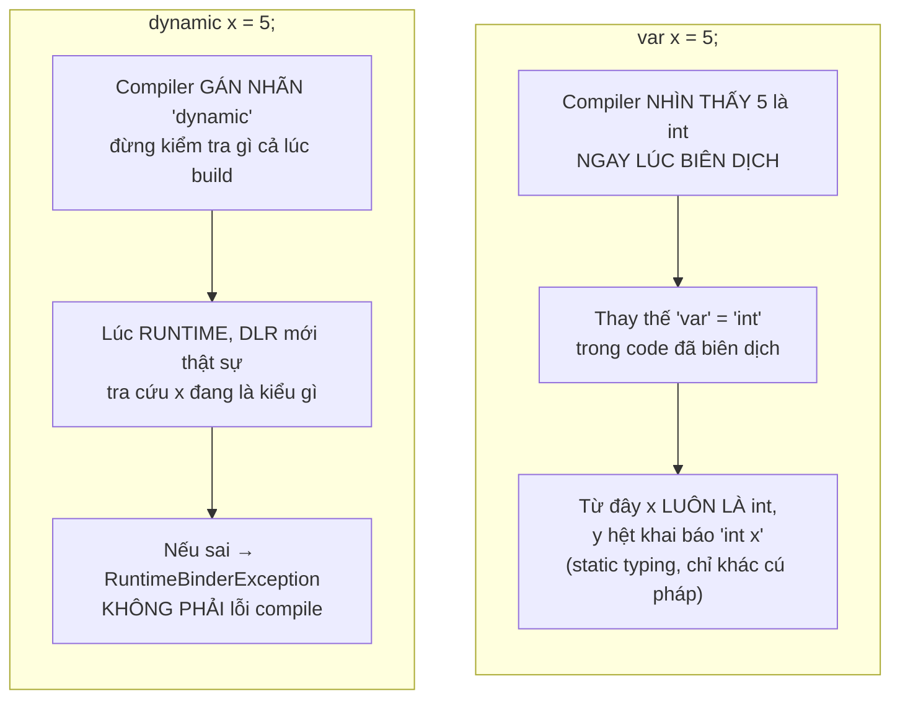

# 02 — OOP chuyên sâu, Generics, Delegate/Event, Collections, LINQ

---

## 1. OOP — không chỉ là 4 tính chất học thuộc lòng

Ai học C# cũng thuộc lòng "Encapsulation, Inheritance, Polymorphism, Abstraction". Phần này không nhắc lại định nghĩa suông, mà làm rõ bằng ví dụ rồi đi vào **cơ chế runtime bên dưới** và các bẫy thường gặp.

### 1.0. Encapsulation, Abstraction và Access Modifiers — nền trước khi đi sâu

### 🧠 Ví dụ trước — Encapsulation (đóng gói)

```csharp
class BankAccount
{
    private decimal _balance; // ⚠️ giấu kín, KHÔNG cho sửa trực tiếp từ bên ngoài

    public decimal Balance => _balance; // chỉ cho ĐỌC, không cho GHI trực tiếp

    public void Deposit(decimal amount)
    {
        if (amount <= 0) throw new ArgumentException("Số tiền nạp phải dương");
        _balance += amount; // MUỐN đổi _balance, bắt buộc phải đi qua method này
    }
}
```

Nếu để `public decimal Balance` cho sửa tự do (`account.Balance = -1000;`), không ai kiểm soát được việc số dư bị gán âm vô lý. **Encapsulation** là việc **giấu kín dữ liệu nội bộ** (field `_balance`), chỉ cho phép thế giới bên ngoài tương tác qua các method/property đã được kiểm soát (`Deposit`) — đảm bảo object **luôn ở trạng thái hợp lệ (valid state)** tại mọi thời điểm, vì không ai có đường tắt sửa thẳng dữ liệu mà bỏ qua các luật kiểm tra.

### 🧠 Ví dụ trước — Abstraction (trừu tượng hóa)

```csharp
var list = new List<int> { 5, 3, 1 };
list.Sort(); // bạn KHÔNG CẦN biết bên trong dùng thuật toán sort nào (Quicksort? Timsort?)
```

**Abstraction** là việc **che giấu độ phức tạp bên trong**, chỉ phơi ra cho người dùng **"cái gì" (what)** họ cần làm, không bắt họ phải hiểu **"làm thế nào" (how)** bên dưới hoạt động. Gọi `list.Sort()` bạn không cần quan tâm thuật toán sắp xếp cụ thể — đó là chi tiết đã bị trừu tượng hóa đi. `interface`/`abstract class` (nói ở mục 1.2) chính là công cụ ngôn ngữ để chủ động thiết kế sự trừu tượng hóa này.

> 📌 Phân biệt nhanh với Encapsulation: **Encapsulation giấu DỮ LIỆU** (state), **Abstraction giấu ĐỘ PHỨC TẠP của cách làm** (implementation detail). Hai khái niệm hay đi cùng nhau nhưng giải quyết 2 vấn đề khác nhau.

### 📌 Access Modifiers — công cụ thực thi Encapsulation

| Modifier | Truy cập được từ đâu |
|---|---|
| `private` | Chỉ trong **chính class đó** (mặc định nếu không ghi gì, với member) |
| `protected` | Chính class đó **và các class con (kế thừa)**, dù ở assembly khác |
| `internal` | Mọi nơi **trong cùng 1 assembly** (cùng 1 project/.dll), class khác assembly không thấy được |
| `protected internal` | `protected` **HOẶC** `internal` (gộp cả 2 — rộng hơn từng cái riêng lẻ) |
| `private protected` | `protected` **VÀ** `internal` cùng lúc (giao của 2 điều kiện — hẹp hơn `protected internal`) |
| `public` | Mọi nơi, không giới hạn |

✅ **Quy tắc thực dụng:** luôn bắt đầu với phạm vi **hẹp nhất có thể** (`private`), chỉ nới rộng (`protected`/`internal`/`public`) khi **thật sự** có nơi khác cần truy cập. Field dữ liệu (như `_balance`) gần như luôn nên `private`, chỉ phơi ra ngoài qua property/method đã kiểm soát — đây chính là Encapsulation áp dụng vào thực tế hằng ngày.

### 1.1. Virtual, Override, New — Polymorphism thật sự hoạt động thế nào

### 🧠 Ví dụ trước

```csharp
class Animal
{
    public virtual string Sound() => "...";
    public string Name() => "Animal"; // KHÔNG virtual
}
class Dog : Animal
{
    public override string Sound() => "Gâu";
    public new string Name() => "Dog"; // dùng "new" thay vì "override"
}

Animal a = new Dog();
Console.WriteLine(a.Sound()); // "Gâu"
Console.WriteLine(a.Name());  // "Animal" — KHÔNG phải "Dog"!
```

### 📌 Bản chất

- `virtual` + `override` dùng cơ chế **vtable (virtual method table)**: mỗi object có một bảng con trỏ trỏ tới method thật sự sẽ chạy. CLR quyết định gọi method nào **dựa trên type thật của object lúc runtime** (Dog), không phải type khai báo của biến (Animal). Đây gọi là **dynamic dispatch / late binding**.
- `new` (method hiding) thì ngược lại: trình biên dịch quyết định gọi method nào **dựa trên type khai báo của biến lúc compile-time** (Animal), không quan tâm object thật là gì. Đây gọi là **static binding**.

✅ **Quy tắc:** luôn dùng `override` khi muốn polymorphism thật. `new` gần như luôn là dấu hiệu code có vấn đề (hoặc vô tình che method cha) — IDE sẽ cảnh báo "hides inherited member", đừng bỏ qua warning này.

### 1.2. Abstract Class vs Interface — khi nào dùng cái nào

### 🧠 Ví dụ trước

```csharp
abstract class PaymentMethodBase
{
    public abstract decimal CalculateFee(decimal amount); // bắt buộc con implement
    public void Log(string msg) => Console.WriteLine(msg); // code dùng chung, có sẵn
}

interface INotifiable
{
    void Notify(string message); // chỉ là "hợp đồng", (hoặc default method ở C# 8+)
}

class CreditCardPayment : PaymentMethodBase, INotifiable
{
    public override decimal CalculateFee(decimal amount) => amount * 0.02m;
    public void Notify(string message) => Console.WriteLine($"Email: {message}");
}
```

### 📌 Bản chất & khi nào dùng

| | Abstract Class | Interface |
|---|---|---|
| Quan hệ diễn tả | "**is-a**" cùng họ, cùng bản chất (CreditCard **is a** PaymentMethod) | "**can-do**" khả năng, không nhất thiết cùng họ (CreditCardPayment **can** Notify) |
| Kế thừa | Chỉ 1 class cha (C# không đa kế thừa class) | 1 class implement **nhiều** interface |
| Có code dùng chung | Có (field, method có thân, constructor) | Từ C# 8 có thể có **default implementation**, nhưng nên hạn chế lạm dụng |
| Field (biến state) | Có | Không (interface không giữ state) |

✅ Quy tắc thực dụng: Interface để **mô tả khả năng** xuyên suốt nhiều họ class không liên quan (`IDisposable`, `IComparable`, `ILogger`). Abstract class để **chia sẻ code triển khai chung** giữa các class thật sự cùng bản chất.

### 1.3. Sealed — khóa kế thừa

```csharp
sealed class DiscountCalculator { }      // không ai được kế thừa class này nữa
public override sealed string Sound() => "Gâu"; // method này override xong, không cho con cháu override tiếp
```

✅ Dùng khi bạn **chắc chắn** không muốn hành vi bị thay đổi bởi lớp con (bảo toàn tính đúng đắn, tối ưu hiệu năng nhẹ vì JIT không cần lo devirtualize).

### 1.4. Equals, GetHashCode, `==` — bẫy kinh điển

### 🧠 Ví dụ trước

```csharp
class Point { public int X, Y; }

var p1 = new Point { X = 1, Y = 2 };
var p2 = new Point { X = 1, Y = 2 };

Console.WriteLine(p1 == p2);       // False!
Console.WriteLine(p1.Equals(p2));  // False!
```

### 📌 Bản chất

Mặc định, `class` so sánh theo **reference identity** (có phải cùng 1 ô nhớ trên Heap không), chứ không so sánh theo giá trị bên trong. `p1` và `p2` là 2 object khác nhau trên Heap dù giá trị X, Y giống hệt nhau → `==` trả `False`.

Muốn so sánh theo giá trị, phải tự override:

```csharp
class Point
{
    public int X, Y;
    public override bool Equals(object? obj) =>
        obj is Point p && X == p.X && Y == p.Y;
    public override int GetHashCode() => HashCode.Combine(X, Y);
}
```

⚠️ **Quy tắc bắt buộc:** nếu override `Equals`, **luôn phải** override `GetHashCode` theo cùng logic. Lý do: `Dictionary<TKey,TValue>` và `HashSet<T>` dùng `GetHashCode()` để tìm "xô" (bucket) chứa phần tử trước, rồi mới dùng `Equals` để so khớp chính xác trong xô đó. Nếu hai object `Equals()` bằng nhau nhưng `GetHashCode()` khác nhau, chúng sẽ rơi vào 2 xô khác nhau → `Dictionary`/`HashSet` **sẽ không bao giờ tìm thấy nhau**, gây bug cực kỳ khó debug (trông như "có mà tìm hoài không ra").

### 📌 Nên đi kèm `IEquatable<T>` — tránh boxing khi so sánh

```csharp
class Point : IEquatable<Point> // implement thêm interface này
{
    public int X, Y;

    public override bool Equals(object? obj) => obj is Point p && Equals(p); // gọi lại bản IEquatable bên dưới
    public bool Equals(Point? other) => other is not null && X == other.X && Y == other.Y; // overload KHÔNG cần ép kiểu object
    public override int GetHashCode() => HashCode.Combine(X, Y);
}
```

📌 `Equals(object? obj)` nhận tham số kiểu `object` — nếu `Point` là `struct`, gọi `Equals(object)` sẽ **box** giá trị trước khi so sánh (tốn 1 lần cấp phát Heap không cần thiết, nhớ lại file 01 mục 3). `IEquatable<T>` cung cấp thêm overload `Equals(T other)` nhận đúng kiểu cụ thể, không cần ép kiểu qua `object` → tránh hẳn boxing. Nhiều API của .NET (`List<T>.Contains`, `Dictionary` khi so sánh key...) **tự động ưu tiên gọi** `Equals(T)` nếu type có implement `IEquatable<T>`, nên đây gần như luôn nên đi kèm mỗi khi override `Equals` cho 1 `struct`, và là thực hành tốt kể cả với `class`.

✅ Từ C# 9, dùng `record` sẽ tự động sinh `Equals`/`GetHashCode` **và** `IEquatable<T>` theo giá trị tất cả property — không cần tự viết tay (xem mục 5).

### 1.5. Type Casting — ép kiểu an toàn và không an toàn

### 🧠 Ví dụ trước

```csharp
object obj = "hello";
int number = (int)obj; // ⚠️ CRASH lúc runtime: InvalidCastException!
```

Compiler **không báo lỗi lúc biên dịch** vì về mặt cú pháp, ép kiểu từ `object` sang bất kỳ type nào đều hợp lệ — nhưng lúc runtime, CLR kiểm tra thấy object thật sự là `string`, không thể ép thành `int` được, nên ném exception.

### 📌 Các cách ép kiểu, từ an toàn nhất tới rủi ro nhất

```csharp
// 1. Implicit (ngầm định) — compiler TỰ làm, không cần viết gì, vì KHÔNG BAO GIỜ mất dữ liệu
int a = 5;
double b = a; // int → double luôn an toàn (double chứa được mọi giá trị int)

// 2. Explicit (tường minh) — bạn TỰ viết (type), báo compiler "tôi biết có thể mất dữ liệu, vẫn muốn làm"
double c = 5.9;
int d = (int)c; // d = 5 — phần thập phân bị CẮT BỎ (không làm tròn!), phải chủ động viết (int)

// 3. "as" — ép kiểu giữa các reference type, trả về null nếu KHÔNG ép được, KHÔNG BAO GIỜ throw
object obj = "hello";
string? s = obj as string;   // s = "hello"
int[]? arr = obj as int[];   // arr = null — ép thất bại nhưng KHÔNG crash, chỉ trả null

// 4. "is" — chỉ KIỂM TRA xem có ép được không, trả về bool (thường đi cùng pattern matching, xem file này mục 5.2)
if (obj is string str) // vừa kiểm tra, vừa gán luôn vào "str" nếu đúng — 1 bước thay vì 2
    Console.WriteLine(str.Length);
```

✅ **Quy tắc chọn cách ép kiểu:**
- Biết chắc chắn 100% ép được (dựa vào logic chương trình) → dùng `(Type)obj` tường minh, nếu sai thì **nên crash ngay** để lộ bug sớm, đừng cố "nuốt" lỗi.
- Không chắc có ép được không, và muốn xử lý nhẹ nhàng khi thất bại (không muốn crash) → dùng `as` (cho reference type) kết hợp kiểm tra `null`, hoặc `is`/pattern matching để vừa kiểm tra vừa dùng luôn trong 1 bước — tránh hẳn exception, nhanh hơn try/catch (nhớ lại file 03: exception rất đắt).

⚠️ Lưu ý `as` **chỉ dùng được với reference type** (hoặc `Nullable<T>`) — vì cần trả về được `null` khi thất bại; không dùng được với value type thường như `int`, `bool`.

---

## 2. Generics — vì sao không chỉ là "cú pháp với dấu `<>`"

### 🧠 Ví dụ trước

```csharp
// KHÔNG dùng generic — phải viết lại cho từng type, hoặc dùng object (boxing + unsafe cast)
class IntBox { public int Value; }
class StringBox { public string Value; }

// DÙNG generic — viết 1 lần, dùng cho mọi type
class Box<T> { public T Value; }

var intBox = new Box<int> { Value = 5 };       // T = int, KHÔNG boxing
var strBox = new Box<string> { Value = "hi" }; // T = string
```

### 📌 Bản chất: Generic không "biến mất" lúc runtime như Java (type erasure)

.NET dùng cơ chế gọi là **Reified Generics**:
- Với **value type** (`Box<int>`, `Box<double>`...): CLR tạo ra **native code riêng cho từng type cụ thể** lúc JIT compile → không boxing, truy cập nhanh như viết tay `IntBox`.
- Với **reference type** (`Box<string>`, `Box<Customer>`...): các type này đều là con trỏ cùng kích thước (8 byte trên hệ 64-bit) nên CLR **chia sẻ chung 1 bản native code** cho tất cả generic instantiation của reference type, tiết kiệm bộ nhớ assembly.

Đây là lý do `List<int>` nhanh hơn hẳn `ArrayList` (chứa `object`, phải boxing từng `int`) — đã nói ở file 01.

### 2.1. Generic Constraints — ép buộc T phải có khả năng gì

```csharp
class Repository<T> where T : class, IEntity, new()
{
    public T CreateNew() => new T(); // nhờ "new()" nên được phép new T()
}

interface IEntity { int Id { get; } }
```

| Constraint | Ý nghĩa |
|---|---|
| `where T : class` | T phải là reference type |
| `where T : struct` | T phải là value type |
| `where T : IComparable<T>` | T phải implement interface này (gọi được `CompareTo`) |
| `where T : BaseClass` | T phải kế thừa BaseClass cụ thể |
| `where T : new()` | T phải có constructor không tham số (để `new T()` hợp lệ) |

✅ Constraint giúp bạn **viết code generic mà vẫn gọi được method cụ thể** trên `T` (nếu không có constraint, compiler chỉ cho phép gọi những method có trên `object`).

### 2.2. Covariance / Contravariance (`out`, `in`) — chủ đề hay bị bỏ qua

### 🧠 Ví dụ trước

```csharp
IEnumerable<string> strings = new List<string>();
IEnumerable<object> objects = strings; // HỢP LỆ — vì sao?
```

### 📌 Bản chất

```csharp
public interface IEnumerable<out T> { ... }   // "out" = covariant
```

`out T` nghĩa là T chỉ xuất hiện ở **vị trí trả về (output)**, không bao giờ nhận vào làm tham số. Vì vậy an toàn khi coi `IEnumerable<string>` là `IEnumerable<object>` — bạn chỉ **đọc ra** string, mà string luôn "is-a" object, không bao giờ ai add thêm phần tử object khác vào collection qua interface này.

✅ Ghi nhớ nhanh: **"out" = covariant = trả về (an toàn vì chỉ đọc)**, **"in" = contravariant = nhận vào (an toàn vì chỉ ghi/so sánh)**. `Action<in T>` là ví dụ contravariant: `Action<object>` dùng được chỗ cần `Action<string>`, vì hàm nhận object xử lý được cả string truyền vào.

### 2.3. Extension Methods — "thêm" method cho type có sẵn mà không sửa mã nguồn gốc

### 🧠 Ví dụ trước

```csharp
string input = "   ";

// Làm sao kiểm tra "chuỗi rỗng hoặc toàn khoảng trắng" gọn gàng, mà string.cs không phải code của mình để sửa?
bool isBlank = string.IsNullOrWhiteSpace(input); // cách có sẵn — hơi dài, phải nhớ tên static method

bool isBlank2 = input.IsBlank(); // ✅ muốn viết GỌN như thế này — nhưng "IsBlank" không có sẵn trên string!
```

### 📌 Cách tự tạo

```csharp
public static class StringExtensions // BẮT BUỘC: class static
{
    public static bool IsBlank(this string value) // BẮT BUỘC: tham số đầu tiên có "this"
        => string.IsNullOrWhiteSpace(value);
}

// Chỉ cần "using" đúng namespace chứa class trên, MỌI string trong project đều gọi được .IsBlank()
bool isBlank2 = input.IsBlank();
```

### 📌 Bản chất

Extension Method **không thật sự thêm method vào type gốc** (bạn không hề sửa file nguồn của `string`, cũng không thể — `string` đã compile sẵn trong thư viện .NET). Đây hoàn toàn là **"ảo thuật cú pháp" (syntactic sugar)**: compiler thấy `input.IsBlank()`, nhưng `string` không có method `IsBlank`, nó sẽ **tự tìm** trong các `static class` đã được `using`, thấy `StringExtensions.IsBlank(string value)` khớp, rồi **âm thầm viết lại thành** lời gọi static bình thường:

```csharp
bool isBlank2 = StringExtensions.IsBlank(input); // đây là những gì ACTUALLY chạy bên dưới
```

✅ **Khi nào dùng:** khi muốn thêm hành vi tiện ích cho type **mình không sở hữu mã nguồn** (type có sẵn của .NET, hoặc type từ thư viện bên thứ 3), hoặc muốn gom các hàm tiện ích rải rác thành method gọi tự nhiên theo kiểu "chuỗi" (fluent, ví dụ cách LINQ `.Where().Select().OrderBy()` được xây dựng — toàn bộ LINQ thực chất chính là **hàng loạt Extension Method** viết trên `IEnumerable<T>`).

⚠️ Đừng lạm dụng để "nhét" logic nghiệp vụ phức tạp vào Extension Method của type cơ bản (`string`, `int`...) — dễ làm logic nghiệp vụ bị rải rác, khó tìm. Phù hợp nhất cho hàm tiện ích thuần túy, ngắn gọn, không phụ thuộc gì (stateless).

---

## 3. Delegate, Event, Lambda — cơ chế callback trong C#

### 🧠 Ví dụ trước

```csharp
delegate int MathOp(int a, int b);

int Add(int a, int b) => a + b;
MathOp op = Add;
Console.WriteLine(op(2, 3)); // 5 — gọi method Add() thông qua biến "op"
```

### 📌 Bản chất

`delegate` là một **type đại diện cho một hoặc nhiều method có cùng chữ ký (signature)**. Về bản chất, một biến `delegate` là một object trên Heap giữ danh sách con trỏ method (gọi là **invocation list**) — vì vậy delegate hỗ trợ **multicast** (gộp nhiều method vào 1 lời gọi):

```csharp
MathOp op = Add;
op += Subtract;      // gộp thêm — invocation list giờ có 2 method
op(2, 3);            // gọi LẦN LƯỢT cả Add và Subtract, trả về kết quả của method CUỐI CÙNG
```

⚠️ **Bẫy:** nếu delegate trả về giá trị (`int` ở ví dụ trên) mà multicast nhiều method, bạn chỉ nhận được kết quả của method cuối — kết quả các method trước **bị âm thầm bỏ qua**. Multicast chỉ thật sự an toàn khi delegate kiểu `void` (như `event`).

### 3.1. `Func`, `Action`, `Predicate` — delegate dựng sẵn, không cần tự khai báo

```csharp
Func<int, int, int> add = (a, b) => a + b;       // có tham số, CÓ trả về
Action<string> log = msg => Console.WriteLine(msg); // có tham số, KHÔNG trả về
Predicate<int> isEven = n => n % 2 == 0;          // nhận 1 tham số, trả về bool
```

Hầu như 100% trường hợp dùng delegate trong code hiện đại là 1 trong 3 cái trên — tự khai báo `delegate` riêng giờ chỉ cần khi muốn đặt tên type có ý nghĩa nghiệp vụ rõ ràng.

### 3.2. Event — delegate "có khuôn phép"

### 🧠 Ví dụ trước

```csharp
class Button
{
    public event Action<string>? Clicked; // CHỈ class Button được RAISE event này

    public void SimulateClick() => Clicked?.Invoke("Button1");
}

var btn = new Button();
btn.Clicked += msg => Console.WriteLine($"Clicked: {msg}");
btn.SimulateClick();
```

### 📌 Bản chất

`event` thực chất là một `delegate` được **bọc thêm lớp bảo vệ truy cập (encapsulation)**: code bên ngoài class chỉ được `+=` / `-=` (đăng ký/hủy đăng ký), **không được tự ý gọi `Invoke()`** hay gán đè (`=`) từ bên ngoài. Chỉ class khai báo event mới raise được nó. Đây chính là design pattern **Observer** được tích hợp sẵn vào ngôn ngữ.

⚠️ Luôn dùng `?.Invoke(...)` (null-conditional) khi raise event, vì nếu chưa ai đăng ký (`Clicked` đang là `null`), gọi thẳng `Clicked(...)` sẽ ném `NullReferenceException`.

⚠️ Nhớ lại phần GC ở file 01: **event là nguyên nhân rò rỉ bộ nhớ phổ biến nhất** nếu publisher sống lâu hơn subscriber mà subscriber quên `-=`.

---

## 4. Collections & độ phức tạp (Big-O) — chọn đúng cấu trúc dữ liệu

### 🧠 Ví dụ trước

Bạn cần tra cứu 1 triệu khách hàng theo `CustomerId` liên tục trong vòng lặp. Dùng `List<Customer>` rồi `.FirstOrDefault(c => c.Id == id)` mỗi lần tra cứu sẽ **quét tuần tự từ đầu** — với 1 triệu phần tử, tra 1 triệu lần = 10^12 phép so sánh, máy đơ. Đổi sang `Dictionary<int, Customer>` thì mỗi lần tra cứu gần như tức thì.

### 📌 Array vs `List<T>` — nhắc trước khi vào bảng tổng hợp

```csharp
int[] fixedArray = new int[5];      // kích thước CỐ ĐỊNH ngay từ lúc tạo, không đổi được
var dynamicList = new List<int>();  // tự động phình to (resize) khi Add thêm phần tử
dynamicList.Add(1);
```

📌 `Array` (`int[]`) là cấu trúc **kích thước cố định**, cấp phát 1 khối liền kề trên Heap ngay lúc tạo — nhanh và tiết kiệm bộ nhớ nhất nếu bạn **biết trước chính xác** số lượng phần tử. `List<T>` thực chất **bọc bên trong 1 mảng** (array) như vậy, nhưng tự động cấp phát mảng mới lớn hơn (thường gấp đôi) và copy dữ liệu cũ sang khi mảng hiện tại đầy — đổi lại sự tiện lợi "không cần biết trước kích thước" lấy một ít chi phí resize ngầm (đã nói ở ghi chú "amortized" bên dưới bảng).

✅ **Quy tắc:** không biết trước số lượng phần tử, hoặc cần resize linh hoạt → `List<T>` (mặc định dùng trong hầu hết trường hợp). Biết chắc kích thước cố định và cần tối ưu hiệu năng/bộ nhớ ở mức thấp nhất (vòng lặp cực nóng, xử lý dữ liệu lớn) → `Array` thuần.

### 📌 Bảng tổng hợp lựa chọn (đây là bảng quan trọng nhất của chương này)

| Cấu trúc | Bản chất bên trong | Thêm cuối | Tìm theo index/key | Tìm theo giá trị (không biết vị trí) | Khi nào dùng |
|---|---|---|---|---|---|
| `List<T>` | Mảng động (array), tự resize (nhân đôi) khi đầy | O(1) * | O(1) theo index | O(n) | Danh sách có thứ tự, truy cập theo index, duyệt tuần tự |
| `Dictionary<K,V>` | Hash table (mảng các "xô" bucket, dùng `GetHashCode()`) | O(1) | O(1) theo key | — | Tra cứu nhanh theo key (cache, lookup table) |
| `HashSet<T>` | Giống Dictionary nhưng chỉ lưu key, không lưu value | O(1) | — | O(1) kiểm tra tồn tại | Khử trùng lặp, kiểm tra "có tồn tại không" cực nhanh |
| `Queue<T>` | Mảng vòng (circular buffer) | Enqueue O(1) | — | — | Xử lý theo thứ tự **FIFO** (vào trước ra trước) — hàng đợi task, BFS |
| `Stack<T>` | Mảng động | Push O(1) | — | — | Xử lý theo thứ tự **LIFO** (vào sau ra trước) — undo/redo, DFS, đệ quy |
| `LinkedList<T>` | Danh sách liên kết đôi, mỗi node 1 object riêng trên Heap | O(1) ở đầu/cuối | O(n) theo index | O(n) | Thêm/xóa liên tục ở giữa danh sách mà không cần dịch chuyển phần tử |
| `SortedDictionary<K,V>` | Cây nhị phân cân bằng (Red-Black Tree) | — | O(log n) | — | Cần key **luôn có thứ tự** khi duyệt (`Dictionary` thường không đảm bảo thứ tự) |

\* `List<T>.Add` là O(1) *trung bình* (amortized) — vì khi mảng nội bộ đầy, nó phải cấp phát mảng mới gấp đôi và copy toàn bộ phần tử cũ sang (1 lần O(n) hiếm hoi), nhưng tính trung bình trên nhiều lần Add thì vẫn coi là O(1).

> 📌 Về cái tên "Heap" dễ nhầm lẫn thứ ba: còn có cấu trúc dữ liệu tên **Heap (đống nhị phân / binary heap)** — nền tảng của `PriorityQueue<TElement, TPriority>` (có sẵn từ .NET 6+). Đây là cây nhị phân đặc biệt luôn giữ phần tử nhỏ nhất (hoặc lớn nhất) ở gốc, dùng khi cần liên tục lấy ra phần tử "ưu tiên cao nhất" với chi phí O(log n) — ví dụ xử lý task theo độ ưu tiên, thuật toán Dijkstra. Nó **không liên quan gì đến Heap-vùng-nhớ** đã nói ở file 01 — chỉ trùng tên.

### ⚠️ Lỗi thường gặp

```csharp
// SAI: dùng List để tra cứu lặp đi lặp lại trong vòng lặp lồng nhau → O(n*m)
foreach (var order in orders)
    var customer = customers.FirstOrDefault(c => c.Id == order.CustomerId);

// ĐÚNG: build Dictionary một lần, tra cứu O(1) mỗi lần → tổng O(n+m)
var customerMap = customers.ToDictionary(c => c.Id);
foreach (var order in orders)
    var customer = customerMap.GetValueOrDefault(order.CustomerId);
```

---

## 5. Record, Pattern Matching, var — C# hiện đại

### 5.0. So sánh nhanh: Class vs Struct vs Record

| | `class` | `struct` | `record` |
|---|---|---|---|
| Vị trí lưu trữ (biến local) | Con trỏ trên Stack, object thật trên Heap | Toàn bộ dữ liệu trên Stack (file 01) | Mặc định là `record class` → giống `class` (Heap); có thể khai báo `record struct` → giống `struct` (Stack) |
| Truyền vào hàm | Theo tham chiếu (sửa bên trong hàm ảnh hưởng ra ngoài) | Theo giá trị (copy, sửa bên trong KHÔNG ảnh hưởng ra ngoài) | Theo đúng loại nó dựa trên (`record class` = tham chiếu, `record struct` = giá trị) |
| `==` mặc định | Reference identity (so địa chỉ) | So giá trị từng field | So giá trị từng property (tự sinh `Equals`/`GetHashCode`) |
| Mục đích chính | Business object có hành vi, định danh (identity), có thể thay đổi (mutable) | Dữ liệu nhỏ, hiệu năng cao, không cần định danh | DTO/Value Object bất biến, cần so sánh theo giá trị, cần `with` để tạo bản sao có sửa |

✅ **Quy tắc chọn nhanh:** object có hành vi nghiệp vụ phức tạp, cần theo dõi định danh xuyên vòng đời (Entity theo DDD, file 06) → `class`. Dữ liệu nhỏ, tạo nhiều, không cần định danh, ưu tiên hiệu năng (`Point`, `Money` đơn giản) → `struct`. Dữ liệu truyền qua lại giữa các layer, không nên bị sửa sau khi tạo, cần so sánh bằng giá trị (DTO, Command/Query ở file 06) → `record`.

### 5.1. Record — immutable data object, so sánh theo giá trị "miễn phí"

```csharp
record Point(int X, int Y);

var p1 = new Point(1, 2);
var p2 = new Point(1, 2);
Console.WriteLine(p1 == p2);          // True — record tự override Equals theo giá trị
var p3 = p1 with { Y = 99 };          // "with" tạo bản SAO MỚI, chỉ đổi Y, không sửa p1
```

✅ Dùng `record` cho DTO, Value Object (theo DDD, nói ở file Clean Architecture), dữ liệu bất biến truyền qua các layer — tránh phải tự viết tay `Equals`/`GetHashCode` như mục 1.4.

### 5.2. Pattern Matching — kiểm tra & bóc tách trong 1 bước

```csharp
object shape = new Circle(5);

string description = shape switch
{
    Circle c when c.Radius > 10 => "Hình tròn lớn",
    Circle c                    => $"Hình tròn bán kính {c.Radius}",
    Rectangle { Width: var w, Height: var h } when w == h => "Hình vuông",
    Rectangle r                 => "Hình chữ nhật",
    null                        => "Không có hình",
    _                           => "Không xác định"
};
```

📌 Pattern matching thay thế chuỗi `if (x is Circle) { var c = (Circle)x; ... } else if (x is Rectangle) {...}` dài dòng và dễ sai, bằng cú pháp **vừa kiểm tra type vừa gán biến** trong một bước — giảm hẳn lỗi ép kiểu sai.

### 5.3. `var` vs `dynamic` — nhầm lẫn phổ biến nhất của người mới

### 🧠 Ví dụ trước

```csharp
var a = 5;
a = "text"; // ⚠️ LỖI COMPILE-TIME ngay lập tức: "Cannot implicitly convert type 'string' to 'int'"

dynamic b = 5;
b = "text"; // ✅ BIÊN DỊCH BÌNH THƯỜNG — không báo lỗi gì cả lúc này
```

Hai dòng khai báo trông "giống nhau" về mặt không cần ghi rõ kiểu, nhưng hành vi hoàn toàn trái ngược — đây là hiểu lầm gây bug nhiều nhất cho người mới tiếp xúc `dynamic`.

### 📌 Bản chất: `var` là suy luận kiểu lúc COMPILE-TIME, `dynamic` là bỏ qua kiểm tra tới RUNTIME



| | `var` | `dynamic` |
|---|---|---|
| Kiểu được xác định lúc nào | **Compile-time** (ngay khi build) | **Runtime** (mỗi lần chạy tới dòng đó) |
| Có cần giá trị khởi tạo ngay không | **Bắt buộc** (`var x;` không hợp lệ — compiler cần suy luận kiểu từ đâu đó) | Không bắt buộc |
| Gán lại kiểu khác sau đó | **Không được** (lỗi compile) | **Được** (object có thể đổi "hình dạng" kiểu tùy ý lúc runtime) |
| IDE gợi ý (IntelliSense), bắt lỗi gõ sai tên method | **Có đầy đủ** — vì kiểu đã biết chắc lúc gõ code | **Không có** — IDE không biết trước kiểu thật sự là gì |
| Hiệu năng | Y hệt kiểu tường minh (vì **là** kiểu tường minh, chỉ ẩn đi cú pháp) | **Chậm hơn** — luôn phải qua 1 lớp tra cứu runtime (dù có cache, xem mục 5.4) |

✅ **Ghi nhớ cốt lõi:** `var` không phải là "kiểu dữ liệu" — nó chỉ là **cách viết tắt**, bảo compiler "tự nhìn vế phải mà suy ra kiểu, đỡ tôi phải gõ lại". Sau khi biên dịch xong, `var` **biến mất hoàn toàn**, chỉ còn kiểu tường minh (`int`, `string`...) y như bạn tự gõ tay — đây là lý do `var` không hề có chi phí hiệu năng. `dynamic` thì **thật sự là 1 kiểu riêng** (`System.Object` về bản chất lưu trữ, nhưng được compiler đánh dấu đặc biệt để **trì hoãn mọi việc gọi method/truy cập property tới tận lúc chạy**).

### 5.4. `dynamic` chi tiết — Dynamic Language Runtime (DLR)

### 🧠 Ví dụ trước

```csharp
dynamic config = new ExpandoObject();
config.SmtpHost = "smtp.example.com"; // "thêm" property ngay lúc runtime, không hề có class nào định nghĩa SmtpHost
config.Port = 587;

Console.WriteLine(config.SmtpHost); // "smtp.example.com"
Console.WriteLine(config.Address);  // ⚠️ KHÔNG lỗi compile, nhưng RuntimeBinderException lúc chạy — property không tồn tại
```

Với `class`/`struct` thông thường, property phải được khai báo trước — không thể "thêm" property tùy ý lúc chạy. `dynamic` kết hợp `ExpandoObject` phá vỡ giới hạn đó: object có thể "mọc thêm" property bất cứ lúc nào, mọi thứ được giải quyết hoàn toàn lúc runtime.

### 📌 Bản chất: Call Site Caching — vì sao `dynamic` không "chậm vô hạn" dù phải tra cứu mỗi lần

Mỗi lần compiler gặp 1 lời gọi trên biến `dynamic` (`config.SmtpHost`), nó **không biết gì** về kiểu thật sự lúc build, nên sinh ra code gọi tới **DLR (Dynamic Language Runtime)** — một tầng trung gian chạy lúc runtime, có nhiệm vụ: "tìm xem object này thật sự có property/method tên này không, rồi thực thi nó". Để tránh phải tra cứu lại từ đầu (tốn kém) ở **mỗi lần** gọi, DLR dùng kỹ thuật **Call Site Caching**: lần gọi đầu tiên tại 1 dòng code cụ thể sẽ tra cứu đầy đủ và "nhớ lại" kết quả (cache) ngay tại chính dòng đó; nếu lần sau object vẫn cùng kiểu, nó dùng thẳng kết quả đã cache, nhanh gần bằng gọi tĩnh — chỉ **lần gọi đầu tiên** (hoặc khi kiểu object đổi khác) mới thật sự chậm.

### 📌 Khi nào `dynamic` thật sự cần thiết (hiếm khi cần trong code nghiệp vụ thông thường)

- **COM Interop** (tương tác với Microsoft Office qua COM, hoặc thư viện COM cũ): API COM cũ thường có chữ ký rất linh hoạt, khó khai báo type tĩnh chính xác — `dynamic` giúp code gọi COM API ngắn gọn hơn nhiều so với cách khai báo kiểu tường minh phức tạp trước đây.
- **Xử lý dữ liệu không biết trước cấu trúc** (JSON linh hoạt, kết quả trả về thay đổi tùy ngữ cảnh) — dù trong code hiện đại, `System.Text.Json` với `JsonDocument`/kiểu strongly-typed thường là lựa chọn tốt hơn, an toàn hơn `dynamic`.
- **Tương tác với ngôn ngữ động khác** (Python, IronPython) chạy trên cùng CLR.

⚠️ **Hạn chế tối đa trong code nghiệp vụ C# thông thường**: mất hoàn toàn IntelliSense, mất kiểm tra lỗi compile-time (gõ sai tên property chỉ phát hiện ra **khi chạy tới đúng dòng đó**, có thể là sau khi đã deploy lên production), và chậm hơn code tĩnh. Hầu hết trường hợp tưởng cần `dynamic` thực chất giải quyết tốt hơn bằng `interface`, generic, hoặc pattern matching (mục 5.2).

### 5.5. Reflection — nhìn vào chính cấu trúc của chương trình lúc đang chạy

### 🧠 Ví dụ trước

```csharp
class Product { public string Name { get; set; } public decimal Price { get; set; } }

var product = new Product { Name = "Áo thun", Price = 150000 };

Type type = product.GetType(); // lấy "mô tả" của type Product LÚC RUNTIME
foreach (var prop in type.GetProperties())
{
    Console.WriteLine($"{prop.Name} = {prop.GetValue(product)}");
}
// In ra: Name = Áo thun
//        Price = 150000
// ...mà KHÔNG CẦN biết trước Product có những property gì lúc viết code này!
```

### 📌 Bản chất

**Reflection** là khả năng của .NET cho phép chương trình **tự "soi" vào metadata của chính nó** (hoặc của assembly khác) lúc đang chạy: đọc được danh sách class, property, method, attribute... dù lúc **viết code Reflection đó, bạn hoàn toàn không biết trước** sẽ xử lý type cụ thể nào. Nhớ lại file 01: mỗi assembly (`.dll`) không chỉ chứa IL code, mà còn chứa **metadata** mô tả đầy đủ cấu trúc type — Reflection chính là API đọc phần metadata này.

```csharp
Type type = typeof(Product);                 // cách 1: biết trước type lúc compile
Type type2 = product.GetType();               // cách 2: lấy type THẬT của object lúc runtime (hữu ích khi object là tham số kiểu base class/interface)
Type type3 = Type.GetType("MyApp.Product");   // cách 3: tra type CHỈ TỪ 1 CHUỖI TÊN — không cần reference gì tới class đó lúc compile!

object instance = Activator.CreateInstance(type3); // "new Product()" NHƯNG không hề gõ tên class ra trong code
MethodInfo method = type.GetMethod("ToString");
method.Invoke(instance, null); // GỌI method thông qua reflection, như gọi gián tiếp qua "tên"
```

### 📌 Reflection đọc Attribute — cơ chế đứng sau hầu hết framework hiện đại

```csharp
class Product
{
    [Required] // Attribute — chỉ là 1 MẨU METADATA gắn lên property, TỰ NÓ không làm gì cả
    public string Name { get; set; }
}

// Framework validation (ví dụ ASP.NET Core ModelState) dùng REFLECTION để:
foreach (var prop in typeof(Product).GetProperties())
{
    var requiredAttr = prop.GetCustomAttribute<RequiredAttribute>();
    if (requiredAttr != null)
    {
        var value = prop.GetValue(product);
        if (value == null) throw new ValidationException($"{prop.Name} là bắt buộc");
    }
}
```

📌 Đây là điểm mấu chốt cần hiểu: `[Required]`, `[HttpGet]`, `[JsonPropertyName]`... **tự bản thân Attribute không có hành vi gì cả** — nó chỉ là dữ liệu mô tả (metadata) gắn thêm vào class/property/method. **Chính framework** (ASP.NET Core, System.Text.Json, Entity Framework...) dùng Reflection để **đọc** những attribute này lúc khởi động hoặc lúc xử lý request, rồi **tự quyết định hành vi** dựa trên những gì đọc được. Hiểu được điều này giải thích được rất nhiều "phép màu" trong các framework: Dependency Injection container quét assembly tìm class nào implement interface nào (Reflection), ORM map tên cột database sang tên property (Reflection + Attribute), JSON serializer biết field nào cần bỏ qua (`[JsonIgnore]`, đọc qua Reflection).

### ⚠️ Chi phí hiệu năng của Reflection

```csharp
// ⚠️ CHẬM — mỗi lần gọi đều phải tra cứu metadata, tìm property theo tên (string lookup)
for (int i = 0; i < 1_000_000; i++)
    type.GetProperty("Price").GetValue(product);

// ✅ NHANH HƠN NHIỀU — biên dịch 1 LẦN duy nhất thành delegate thật sự, dùng lại triệu lần sau đó gần như miễn phí
var getter = (Func<Product, decimal>)Delegate.CreateDelegate(typeof(Func<Product, decimal>), type.GetProperty("Price").GetGetMethod());
for (int i = 0; i < 1_000_000; i++)
    getter(product);
```

Reflection (`GetProperty`, `Invoke`...) tra cứu bằng **tên chuỗi (string)** mỗi lần gọi — tương đối chậm so với gọi method/property trực tiếp. ✅ **Quy tắc thực dụng:** nếu cần dùng Reflection lặp lại nhiều lần lên cùng 1 type (không phải chỉ 1 lần lúc khởi động app), hãy **cache lại kết quả** dưới dạng delegate hoặc dùng `Expression Tree`/`System.Reflection.Emit` biên dịch sẵn — đây chính xác là cách các thư viện serializer/ORM hiệu năng cao (như `System.Text.Json`) xử lý: chỉ "trả giá" Reflection **1 lần** cho mỗi type (thường lúc khởi động hoặc lần đầu gặp type đó), rồi tái sử dụng delegate đã biên dịch cho mọi lần sau.

✅ **Khi nào nên tự dùng Reflection trong code nghiệp vụ:** hiếm khi cần trực tiếp — thường bạn đang **dùng lại** Reflection gián tiếp qua framework (attribute validation, DI, serialization) mà không biết. Tự viết tay Reflection hợp lý khi: viết công cụ/framework riêng (ví dụ 1 mini ORM, 1 mini DI container), viết unit test cần truy cập `private` member để test (hạn chế, thường là dấu hiệu nên refactor), hoặc xử lý plugin/assembly nạp động lúc runtime (không biết trước type nào sẽ được nạp).

### 5.6. Nullable Reference Types — bắt lỗi `null` ngay lúc biên dịch

### 🧠 Ví dụ trước

```csharp
class Customer { public string Name { get; set; } public Address? ShippingAddress { get; set; } }

Customer? FindCustomer(int id) => null; // giả sử không tìm thấy

var customer = FindCustomer(1);
Console.WriteLine(customer.Name); // ⚠️ nếu không có Nullable Reference Types, đây là "quả bom hẹn giờ"
                                   // — biên dịch OK, nhưng CRASH lúc runtime nếu FindCustomer trả về null
```

`NullReferenceException` được chính người phát minh ra khái niệm reference (Tony Hoare) gọi là **"sai lầm trị giá hàng tỷ đô la"** — vì compiler trước đây **không hề biết** (và không bắt lỗi) việc 1 biến reference type có thể đang là `null`, mọi thứ chỉ vỡ lở lúc runtime, thường là ở production.

### 📌 Bản chất: bật `<Nullable>enable</Nullable>` để compiler "nhớ thêm" trạng thái null

```xml
<!-- trong file .csproj -->
<PropertyGroup>
  <Nullable>enable</Nullable>
</PropertyGroup>
```

Khi bật tính năng này (mặc định bật sẵn với project tạo mới từ .NET 6+), **mọi reference type được xem là KHÔNG ĐƯỢC PHÉP null theo mặc định**, trừ khi bạn chủ động đánh dấu bằng `?`:

```csharp
string name = null;   // ⚠️ COMPILER WARNING: "Cannot convert null literal to non-nullable reference type"
string? nickname = null; // ✅ OK — "?" báo cho compiler biết: "biến này CÓ THỂ null, hãy kiểm tra trước khi dùng"

void Print(string? input)
{
    Console.WriteLine(input.Length);  // ⚠️ WARNING: "input" có thể null, truy cập .Length không an toàn
    if (input != null)
        Console.WriteLine(input.Length); // ✅ không còn warning — compiler NHẬN RA bạn đã kiểm tra null ở dòng trên
}
```

⚠️ **Lưu ý cực kỳ quan trọng:** đây **chỉ là warning lúc compile** (phân tích tĩnh — static analysis), **không phải lỗi**, và **không sinh ra bất kỳ đoạn kiểm tra null nào trong IL lúc runtime** (khác hẳn bản chất "thật sự an toàn" của ngôn ngữ như Kotlin). Tức là: code vẫn **biên dịch và chạy được** dù có warning, và **vẫn có thể** gặp `NullReferenceException` thật lúc runtime nếu:
- Dữ liệu tới từ bên ngoài ranh giới kiểm tra của compiler (deserialize JSON thiếu field, đọc từ database trả về `NULL`, gọi thư viện cũ chưa bật Nullable).
- Bạn cố tình "ép" compiler im lặng bằng **null-forgiving operator** `!`:

```csharp
string? maybeNull = GetValue();
string definitelyNotNull = maybeNull!; // dấu "!" nói với compiler: "TÔI CHẮC CHẮN cái này không null, đừng cảnh báo nữa"
// ⚠️ nếu bạn SAI, vẫn crash NullReferenceException như thường — "!" không thêm bất kỳ kiểm tra runtime nào
```

✅ **Giá trị thật sự của Nullable Reference Types:** nó không "diệt tận gốc" `NullReferenceException`, nhưng biến nguy cơ null từ **thứ ẩn giấu, chỉ phát hiện khi crash lúc chạy**, thành **thứ hiện rõ ngay trên màn hình IDE lúc đang gõ code** (gạch chân vàng cảnh báo) — buộc lập trình viên phải **chủ động suy nghĩ**: "chỗ này có thể null không, tôi đã xử lý chưa?" ngay từ lúc viết, thay vì để tới khi người dùng báo lỗi production.

✅ **Quy tắc thực dụng:** luôn bật `<Nullable>enable</Nullable>` cho project mới. Chỉ đánh dấu `?` cho những property/tham số **thật sự có ý nghĩa nghiệp vụ là "có thể không có giá trị"** (ví dụ `MiddleName?`, `ShippingAddress?` cho khách chưa nhập) — đừng đánh dấu `?` tràn lan chỉ để "cho qua" warning, vì làm vậy xóa bỏ hoàn toàn giá trị của tính năng này.

---

## 6. LINQ — Query cú pháp, nhưng chạy khác hẳn bạn tưởng

### 🧠 Ví dụ trước

```csharp
var query = customers.Where(c => c.Age > 18);  // dòng này CHƯA LỌC GÌ CẢ!

customers.Add(new Customer { Age = 10 }); // thêm 1 khách hàng MỚI sau khi khai báo query

foreach (var c in query) { ... } // ĐẾN LÚC NÀY mới thực sự chạy .Where(), và sẽ
                                   // xét luôn cả khách hàng vừa thêm ở trên
```

### 📌 Bản chất: Deferred Execution (thực thi trì hoãn)

Phần lớn LINQ method trên `IEnumerable<T>` (`.Where`, `.Select`, `.OrderBy`...) **không chạy ngay** khi bạn gọi — chúng chỉ **xây dựng một "công thức"** (một chuỗi iterator lồng nhau), và công thức đó chỉ thực sự thực thi khi bạn **duyệt kết quả** (`foreach`, hoặc gọi `.ToList()`, `.Count()`, `.First()`...).

✅ Lợi ích: tiết kiệm — nếu bạn chỉ cần 3 phần tử đầu (`.Take(3)`), LINQ sẽ không xử lý toàn bộ danh sách triệu phần tử.
⚠️ Hệ quả nguy hiểm: nếu nguồn dữ liệu thay đổi giữa lúc khai báo và lúc duyệt (như ví dụ trên), hoặc nếu bạn duyệt cùng một query **nhiều lần**, LINQ sẽ **chạy lại từ đầu mỗi lần** — tốn hiệu năng nếu nguồn là query database.

```csharp
var expensiveQuery = data.Where(x => SlowCheck(x)); // SlowCheck() chưa chạy

var count = expensiveQuery.Count();   // chạy SlowCheck() cho TẤT CẢ phần tử — LẦN 1
var list = expensiveQuery.ToList();   // chạy SlowCheck() LẠI TỪ ĐẦU — LẦN 2 (lãng phí!)

// Sửa: gọi .ToList() MỘT LẦN, giữ kết quả, dùng lại nhiều lần
var materialized = data.Where(x => SlowCheck(x)).ToList();
```

### 📌 `IEnumerable<T>` vs `IQueryable<T>` — khác biệt sống còn khi dùng Entity Framework

| | `IEnumerable<T>` | `IQueryable<T>` |
|---|---|---|
| Nơi thực thi | Trong **bộ nhớ ứng dụng** (LINQ to Objects) | Được dịch thành **câu SQL**, chạy dưới database |
| Cách hoạt động | Lambda được compile thành delegate (IL thật) | Lambda được compile thành **Expression Tree** (dữ liệu mô tả cú pháp), rồi EF dịch sang SQL |

```csharp
// data là DbSet<Customer> (IQueryable) — câu này DỊCH RA SQL "WHERE Age > 18", lọc NGAY TRÊN DATABASE
var result = dbContext.Customers.Where(c => c.Age > 18).ToList();

// Nếu lỡ gọi .AsEnumerable() hoặc .ToList() TRƯỚC khi Where — kéo HẾT bảng về rồi mới lọc trong C#!
var badResult = dbContext.Customers.ToList().Where(c => c.Age > 18); // ⚠️ kéo cả bảng về RAM trước
```

Đây là lỗi hiệu năng **cực kỳ phổ biến** khi mới làm việc với EF Core — sẽ nói kỹ hơn ở file [05-EntityFramework.md](05-EntityFramework.md).

---

## 7. Tóm tắt chương

| Khái niệm | Ghi nhớ cốt lõi |
|---|---|
| Encapsulation vs Abstraction | Giấu DỮ LIỆU (state) vs giấu ĐỘ PHỨC TẠP của cách làm (implementation) |
| Access Modifiers | Luôn bắt đầu hẹp nhất (`private`), chỉ nới rộng khi thật sự cần |
| virtual/override | Dynamic dispatch — runtime chọn method theo type THẬT của object |
| new (method hiding) | Static binding — compiler chọn method theo type KHAI BÁO của biến |
| Interface vs Abstract class | can-do (đa dạng, không state) vs is-a (chia sẻ code, 1 cha) |
| Equals/GetHashCode | Phải override CẢ HAI cùng lúc, nếu không Dictionary/HashSet sẽ "mù"; nên thêm `IEquatable<T>` để tránh boxing |
| Type Casting | `(Type)` khi chắc chắn, `as`/`is` khi không chắc — tránh exception đắt đỏ |
| Generics | Reified thật sự ở runtime (không như Java), value type có native code riêng, tránh boxing |
| Extension Methods | Syntactic sugar — compiler viết lại `x.Method()` thành `static Class.Method(x)` ngầm |
| Delegate/Event | Delegate = multicast con trỏ method; Event = delegate có encapsulation, chỉ chủ mới raise được |
| Collections | Chọn theo thao tác chính: tra cứu nhanh → Dictionary/HashSet; thứ tự FIFO/LIFO → Queue/Stack |
| Class vs Struct vs Record | Có hành vi + identity / dữ liệu nhỏ hiệu năng cao / DTO bất biến so sánh theo giá trị |
| var vs dynamic | var = kiểu xác định lúc COMPILE (biến mất sau build, không tốn hiệu năng); dynamic = xác định lúc RUNTIME qua DLR |
| dynamic / DLR | Bỏ qua kiểm tra compile-time, lỗi chỉ lộ ra lúc chạy tới đúng dòng — hạn chế tối đa, ưu tiên interface/generic |
| Reflection | Đọc metadata (type, property, attribute) lúc runtime — nền tảng của DI, serializer, ORM; cache lại nếu gọi lặp lại nhiều |
| Nullable Reference Types | Chỉ là warning compile-time (static analysis), KHÔNG sinh kiểm tra runtime — không thay thế việc tự kiểm tra null thật sự |
| LINQ | Deferred execution — chưa chạy cho tới khi duyệt; IQueryable dịch ra SQL, IEnumerable chạy trong RAM |

➡️ Tiếp theo: [03-Exception-And-Async.md](03-Exception-And-Async.md) — xử lý lỗi đúng cách và lập trình bất đồng bộ.
