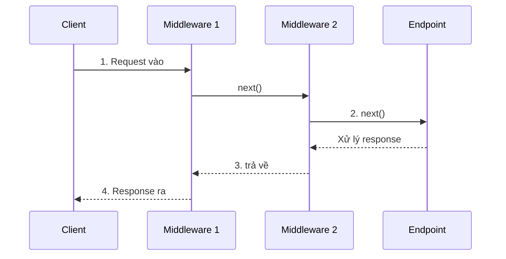

# 04 — .NET Platform: CLR, Dependency Injection, ASP.NET Core

---

## 1. .NET là gì, thật ra? — Phân biệt các khái niệm hay bị lẫn lộn

### 📌 Bản chất

| Thuật ngữ | Là gì |
|---|---|
| **.NET** (trước đây gọi .NET Core) | Nền tảng (platform) mã nguồn mở, đa hệ điều hành (Windows/Linux/macOS) — hiện là chuẩn dùng cho dự án mới |
| **.NET Framework** | Phiên bản cũ, chỉ chạy trên Windows, không còn phát triển thêm tính năng mới (chỉ vá lỗi bảo trì) |
| **CLR (Common Language Runtime)** | "Cỗ máy ảo" thực thi code — nạp assembly, JIT compile, quản lý GC, bảo mật, xử lý exception (đã nói ở file 01) |
| **BCL (Base Class Library)** | Tập hợp class dựng sẵn dùng chung: `String`, `List<T>`, `File`, `HttpClient`... |
| **C#** | Ngôn ngữ lập trình — chỉ là **một trong nhiều** ngôn ngữ chạy trên CLR (còn có F#, VB.NET...) |
| **ASP.NET Core** | Framework xây dựng trên .NET, chuyên để làm web app / Web API |
| **SDK vs Runtime** | SDK = bộ công cụ để **build** (compiler, CLI...). Runtime = chỉ để **chạy** ứng dụng đã build sẵn (không build được) |

➡️ Tức là: C# là ngôn ngữ, .NET là nền tảng chạy nó, ASP.NET Core là framework làm web app **được viết bằng C# chạy trên .NET**. Ba tầng khác nhau, hay bị gộp chung khi nói chuyện.

### 1.1. CTS & CLS — vì sao nhiều ngôn ngữ dùng chung được 1 thư viện `.dll`

- **CTS (Common Type System)**: định nghĩa mọi type (class, struct, interface...) trong .NET phải tuân theo 1 bộ quy tắc chung, bất kể viết bằng ngôn ngữ nào. Nhờ vậy, một `class` viết bằng C# và một `class` viết bằng F# đều biên dịch ra IL theo cùng 1 "khuôn", gọi lẫn nhau được.
- **CLS (Common Language Specification)**: tập con quy tắc **nhỏ hơn** CTS, đảm bảo một thư viện viết ra sẽ dùng được bởi **mọi** ngôn ngữ .NET (kể cả ngôn ngữ không hỗ trợ `unsigned int` như VB.NET cũ) — khi publish thư viện công khai (NuGet), nên tuân thủ CLS để không giới hạn người dùng.

---

## 2. Dependency Injection (DI) — không phải "tính năng của framework", mà là một nguyên tắc thiết kế

### 🧠 Ví dụ trước

```csharp
// ⚠️ KHÔNG dùng DI — class tự new ra dependency của mình
class OrderService
{
    private readonly SqlOrderRepository _repo = new SqlOrderRepository(); // tự tạo, tự buộc chết cứng vào SQL

    public void PlaceOrder(Order order) => _repo.Save(order);
}
```

Vấn đề: muốn viết **unit test** cho `OrderService` mà không chạm vào SQL Server thật? Không thể — vì `OrderService` tự `new` ra `SqlOrderRepository` bên trong, không có cách nào "thay thế" nó bằng bản giả (fake/mock).

```csharp
// ✅ DÙNG DI — dependency được "tiêm" từ bên ngoài vào qua constructor
interface IOrderRepository { void Save(Order order); }

class OrderService
{
    private readonly IOrderRepository _repo;
    public OrderService(IOrderRepository repo) => _repo = repo; // nhận từ bên ngoài, KHÔNG tự new

    public void PlaceOrder(Order order) => _repo.Save(order);
}
```

Giờ muốn test, chỉ cần truyền vào 1 `FakeOrderRepository` giả lập (hoặc dùng thư viện mock như Moq) thay vì đụng tới SQL thật.

### 📌 Bản chất: Inversion of Control (IoC)

DI là cách hiện thực nguyên tắc **Inversion of Control**: thay vì class **tự chủ động** tạo ra thứ nó cần (control nằm trong class), ta **đảo ngược quyền kiểm soát** ra bên ngoài — một "ai đó" (DI Container) chịu trách nhiệm tạo và "tiêm" dependency vào. Class giờ chỉ khai báo **nó cần gì** (qua interface trong constructor), không quan tâm **ai cung cấp** thứ đó.

### 2.1. 3 vòng đời (Lifetime) trong ASP.NET Core DI Container

```csharp
builder.Services.AddSingleton<ICacheService, MemoryCacheService>(); // 1 instance DUY NHẤT, dùng suốt vòng đời app
builder.Services.AddScoped<IOrderRepository, SqlOrderRepository>();  // 1 instance MỚI cho MỖI HTTP request
builder.Services.AddTransient<IEmailSender, SmtpEmailSender>();      // 1 instance MỚI MỖI LẦN được yêu cầu (dù cùng 1 request)
```

| Lifetime | Tạo mới khi nào | Ví dụ phù hợp |
|---|---|---|
| **Singleton** | 1 lần duy nhất cho cả ứng dụng | Cache trong RAM, Configuration, Logger |
| **Scoped** | 1 lần cho mỗi HTTP request (dùng lại trong cùng request) | `DbContext` của Entity Framework — đây là mặc định chuẩn |
| **Transient** | Mỗi lần có ai yêu cầu (inject) | Service nhẹ, không giữ state, không tốn kém để tạo |

⚠️ **Bẫy nguy hiểm nhất: Captive Dependency** — Singleton **không được** phụ thuộc vào Scoped:

```csharp
class CacheService // đăng ký Singleton
{
    private readonly AppDbContext _db; // ⚠️ DbContext là Scoped!
    public CacheService(AppDbContext db) => _db = db;
}
```

Vì `CacheService` chỉ tạo 1 lần duy nhất lúc app khởi động, nó sẽ "giữ chết" `AppDbContext` của **request đầu tiên** mãi mãi — các request sau vẫn dùng chung connection/context đó, dẫn tới lỗi dữ liệu chéo giữa các user, hoặc exception `DbContext đã bị Dispose` (vì ASP.NET tự Dispose Scoped service khi request đó kết thúc, nhưng Singleton vẫn giữ tham chiếu tới object đã chết). ASP.NET Core sẽ **cảnh báo hoặc throw lỗi ngay lúc khởi động** nếu phát hiện kiểu lồng sai này (gọi là *scope validation*) — đừng tắt validation này đi để "cho qua".

✅ Quy tắc nhớ nhanh: **vòng đời ngắn có thể phụ thuộc vòng đời dài hơn** (Transient dùng Singleton: OK), **không bao giờ ngược lại** (Singleton dùng Scoped/Transient: NGUY HIỂM).

### 2.2. Resolve nhiều implementation của cùng 1 interface

### 🧠 Ví dụ trước

Hệ thống cần gửi thông báo qua **cả 3 kênh cùng lúc** (Email, SMS, Push) mỗi khi có đơn hàng mới — không phải chọn 1 trong 3, mà chạy **tất cả**.

```csharp
interface INotificationChannel { Task SendAsync(string message); }

class EmailChannel : INotificationChannel { public Task SendAsync(string m) => /* ... */ Task.CompletedTask; }
class SmsChannel   : INotificationChannel { public Task SendAsync(string m) => /* ... */ Task.CompletedTask; }
class PushChannel  : INotificationChannel { public Task SendAsync(string m) => /* ... */ Task.CompletedTask; }
```

```csharp
// Đăng ký CẢ 3 cùng 1 interface — KHÔNG ghi đè lẫn nhau, container tự gom thành 1 danh sách
builder.Services.AddSingleton<INotificationChannel, EmailChannel>();
builder.Services.AddSingleton<INotificationChannel, SmsChannel>();
builder.Services.AddSingleton<INotificationChannel, PushChannel>();
```

```csharp
class OrderNotifier
{
    private readonly IEnumerable<INotificationChannel> _channels; // inject TẤT CẢ cùng lúc qua IEnumerable<T>

    public OrderNotifier(IEnumerable<INotificationChannel> channels) => _channels = channels;

    public async Task NotifyAllAsync(string message)
    {
        foreach (var channel in _channels) // tự động có đủ 3: Email, Sms, Push
            await channel.SendAsync(message);
    }
}
```

📌 Khi bạn đăng ký **nhiều lần cùng 1 interface** với các class implement khác nhau, DI container của ASP.NET Core **không ghi đè** lần đăng ký trước — nó âm thầm gom tất cả lại thành 1 danh sách nội bộ. Inject `IEnumerable<INotificationChannel>` (thay vì `INotificationChannel` đơn lẻ) sẽ trả về **toàn bộ** danh sách đó, theo đúng thứ tự đã đăng ký.

⚠️ Nếu bạn vô tình inject `INotificationChannel` (không có `IEnumerable<>`) trong tình huống có nhiều đăng ký, container chỉ trả về **implementation ĐĂNG KÝ SAU CÙNG** (`PushChannel` ở ví dụ trên) — không báo lỗi gì cả, chỉ âm thầm "mất" Email và Sms, dễ gây bug khó phát hiện vì không có ngoại lệ nào được ném ra.

### 2.3. Keyed Services (.NET 8+) — nhiều implementation, nhưng cần CHỌN ĐÚNG 1 CÁI theo khóa

### 🧠 Ví dụ trước

Khác với tình huống trên (cần **cả 3** chạy cùng lúc), giờ hệ thống thanh toán cần chọn **đúng 1** cổng thanh toán theo tên provider user chọn — đây là bài toán Factory đã thấy ở file 08, nhưng trước .NET 8 phải tự viết `IPaymentGatewayFactory` tay; từ .NET 8, container có sẵn khái niệm "khóa" (key) để làm đúng việc này.

```csharp
builder.Services.AddKeyedSingleton<IPaymentGateway, VnPayGateway>("vnpay");
builder.Services.AddKeyedSingleton<IPaymentGateway, MomoGateway>("momo");
```

```csharp
class PaymentController
{
    private readonly IPaymentGateway _gateway;

    // [FromKeyedServices] báo container: "lấy ĐÚNG bản đăng ký với khóa 'vnpay'", không phải bản nào khác
    public PaymentController([FromKeyedServices("vnpay")] IPaymentGateway gateway) => _gateway = gateway;
}

// Hoặc resolve thủ công khi khóa chỉ biết được LÚC CHẠY (ví dụ đọc từ request)
IPaymentGateway gateway = serviceProvider.GetRequiredKeyedService<IPaymentGateway>(providerNameFromRequest);
```

✅ **Phân biệt nhanh với mục 2.2:** `IEnumerable<T>` dùng khi cần **TẤT CẢ** implementation cùng lúc (notify mọi kênh). Keyed Services dùng khi có nhiều implementation nhưng mỗi lần chỉ cần **ĐÚNG 1 CÁI cụ thể**, chọn theo 1 "tên" đã biết trước (hoặc biết lúc runtime) — thay thế gọn gàng cho việc tự viết Factory Pattern tay (file 08) chỉ để làm đúng việc "chọn 1 trong N theo điều kiện".

### 2.4. Factory injection — khi cần tạo object LÚC CHẠY theo tham số, container không tự biết trước

### 🧠 Ví dụ trước

DI container resolve dependency dựa trên **type đã đăng ký sẵn lúc khởi động** — nhưng nếu bạn cần tạo nhiều `Report` khác nhau, mỗi cái khởi tạo với 1 `reportId` chỉ biết được **lúc đang chạy** (không phải lúc khởi động app), container không có cách nào tự "đoán" tham số đó.

```csharp
class Report
{
    public Report(int reportId, IReportDataSource dataSource) { /* ... */ } // "reportId" chỉ biết lúc runtime
}

// ⚠️ KHÔNG đăng ký được Report trực tiếp — container không biết "reportId" lấy ở đâu ra
```

```csharp
// ✅ Đăng ký 1 FACTORY DELEGATE, container tự inject sẵn các dependency CỐ ĐỊNH (IReportDataSource),
// còn tham số runtime (reportId) do CHÍNH BẠN truyền vào lúc gọi factory
builder.Services.AddTransient<Func<int, Report>>(sp => reportId =>
    new Report(reportId, sp.GetRequiredService<IReportDataSource>()));

class ReportController
{
    private readonly Func<int, Report> _reportFactory;
    public ReportController(Func<int, Report> reportFactory) => _reportFactory = reportFactory;

    public void Generate(int id)
    {
        var report = _reportFactory(id); // TẠO object MỚI, đúng lúc cần, với tham số runtime
    }
}
```

📌 Thay vì inject thẳng `Report`, bạn inject **1 "cái máy tạo ra Report"** (`Func<int, Report>`) — container chỉ cần biết cách tạo ra "cái máy" đó (các dependency cố định của `Report` đã inject sẵn bên trong lambda), còn tham số thay đổi theo từng lần gọi thì để code của bạn tự truyền vào lúc cần, không phải lúc khởi động app.

### ⚠️ Service Locator — anti-pattern cần tránh, dễ nhầm với Factory ở trên

```csharp
// ⚠️ ANTI-PATTERN: inject thẳng IServiceProvider rồi tự ý "xin" dependency bên trong thân method
class OrderService
{
    private readonly IServiceProvider _provider;
    public OrderService(IServiceProvider provider) => _provider = provider; // che giấu TOÀN BỘ dependency thật sự

    public void PlaceOrder(Order order)
    {
        var repo = _provider.GetRequiredService<IOrderRepository>(); // "xin" ngay trong thân method, không qua constructor
        repo.Save(order);
    }
}
```

📌 Khác biệt cốt lõi với Factory injection (mục 2.4): Factory injection vẫn khai báo **rõ ràng, tường minh** trong constructor "tôi cần 1 cái máy tạo Report" — người đọc code, công cụ test, đều thấy ngay dependency thật sự là gì. Service Locator thì **giấu nhẹm** mọi dependency thật sự đằng sau 1 `IServiceProvider` chung chung — nhìn constructor không ai biết `OrderService` thật ra cần những gì, viết unit test phải tự dựng cả 1 `IServiceProvider` giả thay vì chỉ cần mock đúng 1 interface cần dùng. ⚠️ **Quy tắc:** chỉ `IServiceProvider`/`IServiceScopeFactory` mới nên xuất hiện ở đúng những nơi **thật sự cần tạo scope hoặc resolve động** (ví dụ `BackgroundService` ở mục 6 bên dưới) — không bao giờ dùng nó như "cách lười" để né khai báo dependency rõ ràng qua constructor.

### 2.5. `TryAddSingleton`/`TryAddScoped` — tránh đăng ký trùng khi viết thư viện dùng chung

```csharp
public static class LoggingServiceExtensions
{
    public static IServiceCollection AddMyLogging(this IServiceCollection services)
    {
        services.TryAddSingleton<ILogger, ConsoleLogger>(); // CHỈ thêm nếu CHƯA có ai đăng ký ILogger trước đó
        return services;
    }
}
```

📌 `TryAdd*` khác `Add*` ở đúng 1 điểm: nếu interface đó **đã được đăng ký rồi** (bởi chính ứng dụng, hoặc 1 thư viện khác gọi trước), `TryAdd*` **bỏ qua, không ghi đè** — còn `Add*` (như mục 2.2 đã thấy) luôn **cộng dồn thêm 1 bản đăng ký mới**. ✅ Dùng `TryAdd*` khi viết các extension method đóng gói sẵn 1 bộ đăng ký mặc định (thường gặp trong các thư viện NuGet) — để ứng dụng dùng thư viện đó vẫn có thể tự đăng ký implementation riêng **trước khi** gọi `AddMyLogging()`, mà không bị thư viện âm thầm ghi đè mất.

### 2.6. Composition Root — nơi duy nhất nên "biết" tới DI container

📌 **Composition Root** là khái niệm chỉ **1 nơi duy nhất** trong toàn ứng dụng (thường là `Program.cs`) — nơi mọi `AddSingleton`/`AddScoped`/`AddTransient` được gọi, mọi "dây dợ" dependency được ráp lại với nhau. Mọi class khác trong ứng dụng (Controller, Handler, Service...) **không bao giờ** nên tự `new` lên 1 DI container khác, hay tự gọi `services.AddXxx()` rải rác nhiều nơi — toàn bộ việc "ráp dây" nên tập trung đúng 1 chỗ, càng gần entry point của ứng dụng càng tốt.

✅ Lợi ích: muốn biết **toàn bộ** hệ thống dependency của ứng dụng trông ra sao, chỉ cần đọc đúng 1 file (`Program.cs`), không phải lục khắp codebase tìm xem còn chỗ nào đăng ký thêm service ở đâu đó. Đây cũng là lý do câu "class không nên tự `new` dependency của mình" (mục 2.1, 2.2.1... đã học từ đầu file) **không áp dụng** cho chính Composition Root — nó là **ngoại lệ có chủ đích**, vì nhiệm vụ của nó chính là tạo và ráp nối mọi thứ lại.

---

## 3. Middleware Pipeline — ASP.NET Core xử lý 1 request thế nào

### 🧠 Ví dụ trước

```csharp
var app = builder.Build();

app.Use(async (context, next) =>
{
    Console.WriteLine("1. Trước");
    await next(context);
    Console.WriteLine("4. Sau");
});
app.Use(async (context, next) =>
{
    Console.WriteLine("2. Trước");
    await next(context);
    Console.WriteLine("3. Sau");
});
app.Run(async context => await context.Response.WriteAsync("Xin chào"));
```

In ra thứ tự: `1 → 2 → (xử lý response) → 3 → 4`.

### 📌 Bản chất: mô hình "Chuỗi trách nhiệm" (giống lớp hành — onion/nested)



Mỗi middleware được quyền: xử lý trước khi gọi `next()` (đi vào trong), và xử lý sau khi `next()` trả về (đi ra ngoài) — giống như từng lớp vỏ hành bao quanh phần lõi (nơi xử lý request thật sự). Thứ tự `app.Use(...)` được đăng ký quyết định **thứ tự lồng** — middleware đăng ký trước nằm **ngoài cùng**.

✅ Đây là lý do thứ tự đăng ký middleware trong `Program.cs` **cực kỳ quan trọng**:

```csharp
app.UseExceptionHandler("/error");  // nên ở NGOÀI CÙNG — bắt lỗi của TẤT CẢ middleware bên trong
app.UseHttpsRedirection();
app.UseAuthentication();            // PHẢI trước Authorization — phải biết "ai" trước khi biết "được phép làm gì"
app.UseAuthorization();
app.MapControllers();               // endpoint — lõi trong cùng
```

Nếu lỡ đặt `UseAuthorization()` trước `UseAuthentication()`, hệ thống sẽ luôn thấy user "chưa xác định danh tính" khi kiểm tra quyền → luôn từ chối truy cập, dù user đã đăng nhập đúng.

---

## 4. Configuration & Options Pattern

### 🧠 Ví dụ trước

```json
// appsettings.json
{
  "EmailSettings": {
    "SmtpHost": "smtp.example.com",
    "Port": 587
  }
}
```

```csharp
builder.Services.Configure<EmailSettings>(
    builder.Configuration.GetSection("EmailSettings"));

class EmailSettings { public string SmtpHost { get; set; } public int Port { get; set; } }

class EmailSender
{
    private readonly EmailSettings _settings;
    public EmailSender(IOptions<EmailSettings> options) => _settings = options.Value; // được inject, không hardcode
}
```

### 📌 Vì sao dùng Options Pattern thay vì đọc `IConfiguration["EmailSettings:SmtpHost"]` trực tiếp khắp nơi

- **Type-safe**: đọc trực tiếp bằng string key dễ gõ sai (`"EmailSetting"` thiếu chữ `s`) mà chỉ phát hiện lúc runtime. Options Pattern dùng class strongly-typed, IDE gợi ý, bắt lỗi compile-time.
- **Tập trung một nơi**: thay đổi cấu trúc config chỉ sửa 1 class, không phải tìm từng chỗ dùng string key rải rác khắp codebase.
- **IOptionsSnapshot/IOptionsMonitor**: cho phép đọc lại config **mới nhất** khi file thay đổi lúc đang chạy (reload tự động), mà không cần restart app — `IOptions<T>` thường (Singleton) chỉ đọc 1 lần lúc khởi động.

---

## 5. Static vs Instance — nhắc lại cho rõ vì liên quan DI

```csharp
class MathHelper
{
    public static int Square(int x) => x * x; // KHÔNG cần tạo object để gọi
}

MathHelper.Square(5); // gọi thẳng qua tên class
```

📌 Member `static` thuộc về **chính class** (type), không thuộc về một instance (object) cụ thể nào — chỉ có **1 bản duy nhất** tồn tại trong suốt vòng đời ứng dụng, tương tự như Singleton nhưng được CLR quản lý tự động, không qua DI container.

⚠️ **Hệ quả về DI:** method/class `static` **không thể** inject dependency vào (không có constructor instance để tiêm), nên rất khó test (không thể thay thế bằng mock) và dễ vô tình tạo **shared mutable state** nguy hiểm khi nhiều request cùng truy cập field static. Trong code hiện đại dùng DI, nên hạn chế `static` cho những gì thực sự **không có trạng thái** (pure function, hằng số, hàm tiện ích thuần túy như `Math.Max`), tránh dùng cho service có phụ thuộc hay giữ trạng thái nghiệp vụ.

---

## 6. BackgroundService & IHostedService — chạy tác vụ nền trong ASP.NET Core

### 🧠 Ví dụ trước

Bạn cần **mỗi 1 giờ**, tự động quét database xóa các bản ghi tạm (OTP, session hết hạn...) — tác vụ này **không liên quan tới bất kỳ HTTP request nào**, cần tự chạy ngầm suốt vòng đời ứng dụng, song song với việc xử lý các request bình thường.

### 📌 `IHostedService` — interface nền tảng

```csharp
public class CleanupHostedService : IHostedService
{
    public Task StartAsync(CancellationToken cancellationToken)
    {
        Console.WriteLine("Service bắt đầu chạy — gọi 1 LẦN lúc ứng dụng khởi động");
        return Task.CompletedTask;
    }

    public Task StopAsync(CancellationToken cancellationToken)
    {
        Console.WriteLine("Service dừng lại — gọi 1 LẦN lúc ứng dụng tắt (graceful shutdown)");
        return Task.CompletedTask;
    }
}
```

```csharp
builder.Services.AddHostedService<CleanupHostedService>(); // đăng ký — ASP.NET Core TỰ gọi StartAsync/StopAsync đúng lúc
```

📌 `IHostedService` chỉ cho bạn 2 "móc nối" (hook) vào đúng 2 thời điểm: **lúc ứng dụng khởi động xong** (`StartAsync`) và **lúc chuẩn bị tắt** (`StopAsync`) — muốn tự lặp lại công việc định kỳ bên trong, bạn phải tự quản lý (`Timer`, vòng lặp...), khá thủ công.

### ✅ `BackgroundService` — lớp trừu tượng dựng sẵn, dễ dùng hơn nhiều cho tác vụ lặp

```csharp
public class CleanupBackgroundService : BackgroundService
{
    private readonly IServiceScopeFactory _scopeFactory; // xem ⚠️ bên dưới — vì sao KHÔNG inject DbContext trực tiếp

    public CleanupBackgroundService(IServiceScopeFactory scopeFactory) => _scopeFactory = scopeFactory;

    protected override async Task ExecuteAsync(CancellationToken stoppingToken)
    {
        while (!stoppingToken.IsCancellationRequested) // vòng lặp chạy SUỐT vòng đời app, tới khi bị yêu cầu dừng
        {
            using (var scope = _scopeFactory.CreateScope()) // tự tạo 1 "scope" MỚI cho mỗi lần chạy
            {
                var db = scope.ServiceProvider.GetRequiredService<AppDbContext>();
                await db.Sessions.Where(s => s.ExpiresAt < DateTime.UtcNow).ExecuteDeleteAsync(stoppingToken);
            }

            await Task.Delay(TimeSpan.FromHours(1), stoppingToken); // nhớ lại file 03 — await KHÔNG tốn thread trong lúc chờ
        }
    }
}
```

### ⚠️ Bẫy quan trọng nhất: `BackgroundService` là Singleton — không được inject thẳng Scoped service

Nhớ lại mục 2.1 ở trên (Captive Dependency): mọi `IHostedService`/`BackgroundService` được ASP.NET Core đăng ký **như Singleton** (tạo đúng 1 lần, sống suốt vòng đời app). Nếu constructor nhận thẳng `AppDbContext` (vốn là **Scoped**, tạo mới mỗi request) làm tham số, bạn sẽ **tái phạm đúng lỗi Captive Dependency** đã học — `DbContext` đó sẽ bị "giữ chết" mãi mãi, dùng chung giữa các lần chạy tác vụ nền, dễ gây lỗi dữ liệu cũ/exception "context đã bị Dispose".

✅ **Cách giải quyết chuẩn:** inject `IServiceScopeFactory` (bản thân nó an toàn ở Singleton) vào `BackgroundService`, rồi **tự tạo 1 scope mới** (`CreateScope()`) mỗi lần cần dùng service Scoped — y hệt như cách ASP.NET Core tự làm ngầm cho mỗi HTTP request, chỉ khác là bạn phải **tự gọi tay** vì không có request nào kích hoạt sẵn.

### 📌 Khi nào dùng `BackgroundService` thay vì hệ thống job scheduler riêng (Hangfire, Quartz.NET...)

✅ **Phù hợp:** tác vụ nền đơn giản, không cần lịch phức tạp (cron expression), không cần retry/giao diện theo dõi, không cần đảm bảo chạy đúng 1 lần khi scale nhiều instance.

⚠️ **Không phù hợp:** nếu ứng dụng chạy **nhiều instance** (scale-out, file 07) và tác vụ **không được phép chạy trùng lặp** (ví dụ: gửi báo cáo tổng hợp mỗi ngày — không được cả 3 instance cùng gửi 3 lần), `BackgroundService` tự viết tay **không có cơ chế khóa phân tán** để đảm bảo chỉ 1 instance chạy — lúc này nên dùng thư viện job scheduler chuyên dụng (Hangfire, Quartz.NET) có hỗ trợ sẵn distributed lock, hoặc tách hẳn thành 1 service/job riêng biệt ngoài cụm web app.

---

## 7. Tóm tắt chương

| Khái niệm | Ghi nhớ cốt lõi |
|---|---|
| .NET vs .NET Framework vs CLR vs ASP.NET Core | Nền tảng / phiên bản cũ Windows-only / runtime thực thi / framework làm web, 4 tầng khác nhau |
| Dependency Injection | Đảo ngược quyền kiểm soát — class khai báo cần gì, container lo tạo và tiêm vào |
| Singleton/Scoped/Transient | Vòng đời ngắn phụ thuộc vòng đời dài: OK. Ngược lại: nguy hiểm (captive dependency) |
| IEnumerable\<T\> injection | Nhiều đăng ký cùng interface → gom thành danh sách; inject thiếu `IEnumerable<>` chỉ lấy bản ĐĂNG KÝ SAU CÙNG |
| Keyed Services | Chọn ĐÚNG 1 trong N implementation theo "khóa" — thay thế gọn cho tự viết Factory Pattern tay |
| Factory injection (`Func<T>`) | Tạo object với tham số chỉ biết lúc RUNTIME — dependency cố định vẫn khai báo rõ qua constructor |
| Service Locator | Anti-pattern — inject `IServiceProvider` rồi tự resolve tay giấu mất dependency thật sự, khó test |
| TryAddSingleton/Scoped | Chỉ đăng ký nếu CHƯA có ai đăng ký trước — dùng khi viết extension method đóng gói sẵn cho thư viện |
| Composition Root | 1 nơi DUY NHẤT (thường Program.cs) nên gọi Add*/biết tới container — ngoại lệ có chủ đích của nguyên tắc "đừng tự new" |
| Middleware pipeline | Lồng nhau như lớp hành — thứ tự đăng ký quyết định thứ tự chạy |
| Options Pattern | Config strongly-typed, an toàn hơn đọc string key trực tiếp |
| static | Thuộc về type, không phải instance — khó test, tránh dùng cho service có state/dependency |
| BackgroundService | Chạy tác vụ nền — là Singleton, PHẢI tự tạo scope (`IServiceScopeFactory`) để dùng service Scoped như DbContext |

➡️ Tiếp theo: [05-EntityFramework.md](05-EntityFramework.md) — EF Core và các bẫy hiệu năng kinh điển.
