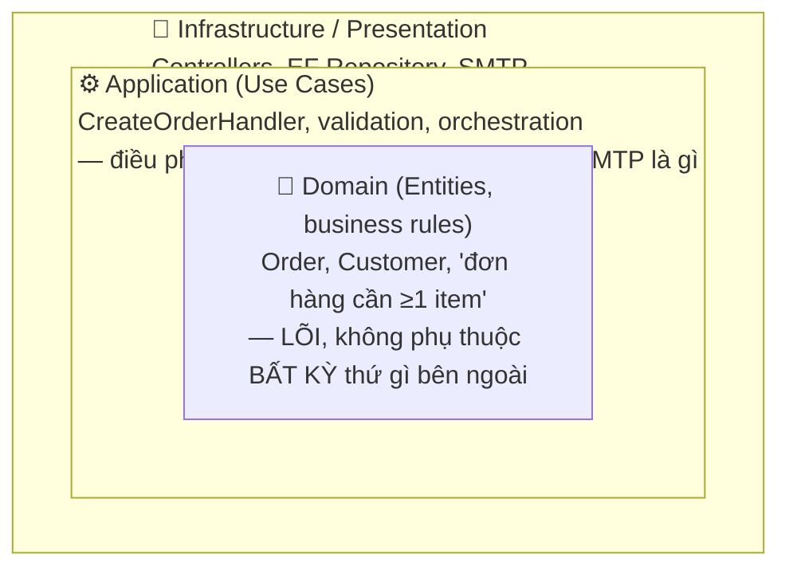

# 06 — Clean Architecture: Tại sao và Làm thế nào

---

## 1. Vấn đề Clean Architecture giải quyết

### 🧠 Ví dụ trước

```csharp
// Controller gọi thẳng EF, trộn lẫn mọi thứ vào 1 nơi
[HttpPost]
public IActionResult CreateOrder(CreateOrderRequest request)
{
    using var context = new AppDbContext(); // phụ thuộc trực tiếp vào EF
    var order = new Order { CustomerId = request.CustomerId };

    if (request.Items.Count == 0) return BadRequest("Đơn hàng phải có ít nhất 1 sản phẩm"); // logic nghiệp vụ nằm trong Controller

    context.Orders.Add(order);
    context.SaveChanges();

    var emailClient = new SmtpClient("smtp.example.com"); // phụ thuộc trực tiếp vào SMTP cụ thể
    emailClient.Send(...);

    return Ok();
}
```

Nhìn qua có vẻ "chạy được", nhưng 6 tháng sau: muốn đổi từ SQL Server sang PostgreSQL? Phải sửa Controller. Muốn viết unit test logic "đơn hàng phải có ít nhất 1 sản phẩm"? Phải dựng cả database thật lên mới test được, vì logic đó dính chặt vào EF và SMTP. Muốn đổi email sang SMS? Lại sửa Controller. **Logic nghiệp vụ cốt lõi bị chôn lẫn với chi tiết kỹ thuật (database, email, HTTP)** — đây chính là vấn đề Clean Architecture giải quyết.

### 📌 Nguyên tắc cốt lõi: The Dependency Rule

> **Mọi phụ thuộc (dependency) chỉ được trỏ vào trong (hướng về phía lõi nghiệp vụ), không bao giờ được trỏ ra ngoài.**



> Mũi tên phụ thuộc (compile-time) luôn chỉ **từ vòng ngoài vào vòng trong** — Infrastructure phụ thuộc Application, Application phụ thuộc Domain, không bao giờ ngược lại.

Vòng tròn **Domain** ở trong cùng chứa logic nghiệp vụ thuần túy (business rules) — tuyệt đối **không được "biết"** sự tồn tại của database, HTTP, hay bất kỳ framework nào. Càng ra ngoài, càng gần với chi tiết kỹ thuật dễ thay đổi theo thời gian (đổi database, đổi UI framework...).

### 📌 Vì sao "Domain không phụ thuộc gì" lại khả thi — Dependency Inversion

### 🧠 Ví dụ trước

```csharp
// Tầng Domain/Application định nghĩa INTERFACE mình cần (không biết ai implement)
namespace Application
{
    public interface IOrderRepository
    {
        void Save(Order order);
    }

    public class CreateOrderHandler
    {
        private readonly IOrderRepository _repo; // chỉ phụ thuộc INTERFACE, nằm CÙNG tầng Application
        public CreateOrderHandler(IOrderRepository repo) => _repo = repo;

        public void Handle(CreateOrderCommand cmd)
        {
            if (cmd.Items.Count == 0)
                throw new DomainException("Đơn hàng phải có ít nhất 1 sản phẩm"); // logic nghiệp vụ Ở ĐÂY

            var order = new Order(cmd.CustomerId, cmd.Items);
            _repo.Save(order);
        }
    }
}

// Tầng Infrastructure IMPLEMENT interface đó, phụ thuộc NGƯỢC VÀO TRONG (vào Application)
namespace Infrastructure
{
    public class EfOrderRepository : Application.IOrderRepository
    {
        private readonly AppDbContext _context;
        public EfOrderRepository(AppDbContext context) => _context = context;
        public void Save(Order order) { _context.Orders.Add(order); _context.SaveChanges(); }
    }
}
```

### 📌 Bản chất

Đây chính là nguyên tắc **D** trong SOLID (Dependency Inversion Principle): tầng cao cấp (Application) **định nghĩa** interface nó cần theo ngôn ngữ nghiệp vụ của chính nó, còn tầng thấp cấp (Infrastructure — nơi chứa EF, SQL...) phải **implement** đúng interface đó. Luồng gọi (runtime, lúc chạy) thì Infrastructure gọi vào Application, nhưng luồng **phụ thuộc biên dịch** (compile-time, ai `using` ai) thì ngược lại: Infrastructure phụ thuộc vào Application (qua interface), chứ Application **không hề biết** `EfOrderRepository` hay `AppDbContext` tồn tại.

✅ Nhờ vậy: `CreateOrderHandler` test được bằng 1 `FakeOrderRepository` giả lập, không cần database thật. Đổi database từ SQL sang Mongo chỉ cần viết `MongoOrderRepository` mới, implement cùng interface — tầng Domain/Application **không cần sửa 1 dòng nào**.

---

## 2. Các tầng cụ thể trong 1 dự án .NET thực tế

| Tầng | Chứa gì | KHÔNG được chứa gì |
|---|---|---|
| **Domain** | Entity (`Order`, `Customer`), Value Object, business rule thuần (ví dụ method `order.CanCancel()`), Domain Event | Bất kỳ reference nào tới EF, ASP.NET, thư viện ngoài |
| **Application** | Use case/Command/Query handler, validation nghiệp vụ, interface của repository (`IOrderRepository`), DTO | Code gọi SQL cụ thể, code gọi HTTP cụ thể |
| **Infrastructure** | Implement `IOrderRepository` bằng EF Core, gửi email thật qua SMTP, gọi API bên thứ 3 | Logic nghiệp vụ ("đơn hàng cần ≥1 item" không được nằm ở đây) |
| **Presentation (API/Web)** | Controller, Razor Page, mapping request/response, authentication | Logic nghiệp vụ, truy vấn database trực tiếp |

### 2.1. Entity vs Value Object (khái niệm DDD cơ bản)

```csharp
// Entity: có IDENTITY (dù 2 đơn hàng giống hệt dữ liệu, vẫn là 2 đơn khác nhau nếu khác Id)
class Order { public Guid Id { get; } public List<OrderItem> Items { get; } }

// Value Object: KHÔNG có identity, so sánh bằng GIÁ TRỊ — 2 Money(100, "VND") luôn "bằng nhau"
record Money(decimal Amount, string Currency); // dùng record — nhớ lại file 02, Equals theo giá trị "miễn phí"
```

📌 Phân biệt này quan trọng vì quyết định cách bạn so sánh và lưu trữ: Entity luôn cần 1 khóa định danh (Id) theo dõi xuyên suốt vòng đời, Value Object thì không — 2 `Money` cùng giá trị có thể dùng thay thế nhau hoàn toàn, không cần quan tâm "instance nào".

### 2.2. Repository Pattern — vì sao không query thẳng `DbContext` trong Application layer

```csharp
public interface IOrderRepository
{
    Order? GetById(Guid id);
    void Save(Order order);
}
```

✅ Repository đóng vai trò "lớp trừu tượng che giấu cách dữ liệu được lưu trữ thật sự" — tầng Application chỉ nói chuyện qua interface này, không quan tâm bên dưới là SQL Server, MongoDB hay file JSON. Đây cũng là nơi dễ bị lạm dụng: **đừng** tạo repository generic kiểu `IRepository<T>` với đầy đủ `GetAll()`, `Where()`... (gọi là "leaky abstraction") vì nó vô tình lộ hết khả năng của `IQueryable` ra ngoài tầng Infrastructure — hãy thiết kế method theo đúng **use case nghiệp vụ cần** (`GetPendingOrdersOlderThan(days)` thay vì để Application tự viết LINQ phức tạp qua 1 `IQueryable` lộ ra ngoài).

---

## 3. CQRS — Command Query Responsibility Segregation

### 🧠 Ví dụ trước

```csharp
// Command: THAY ĐỔI trạng thái hệ thống, KHÔNG trả về dữ liệu nghiệp vụ (chỉ trả Id/thành công)
public record CreateOrderCommand(Guid CustomerId, List<OrderItemDto> Items) : IRequest<Guid>;

// Query: CHỈ ĐỌC dữ liệu, KHÔNG thay đổi gì cả
public record GetOrderByIdQuery(Guid OrderId) : IRequest<OrderDetailsDto>;
```

### 📌 Bản chất

CQRS tách biệt rạch ròi 2 loại thao tác: **Command** (ghi, thay đổi state) và **Query** (đọc, không thay đổi gì). Thay vì 1 "Service" to đùng vừa có `GetOrder()` vừa có `CreateOrder()` vừa có `UpdateOrder()` lẫn lộn, mỗi Command/Query có **1 Handler riêng**, chỉ làm đúng 1 việc.

✅ Lợi ích thực tế:
- **Đơn giản hóa từng class**: mỗi handler ngắn, chỉ lo 1 nghiệp vụ, dễ test, dễ đọc.
- **Tối ưu riêng từng phía**: phía Query có thể bỏ qua hoàn toàn tầng Domain phức tạp, query thẳng ra DTO phẳng bằng SQL thô hoặc `Select` projection (file 05) để tối đa tốc độ đọc — vì Query không cần áp business rule, không cần Change Tracking.
- **Dễ scale riêng**: hệ thống đọc nhiều hơn ghi rất nhiều lần (thường gặp) có thể tách hẳn ra database/cache riêng cho phía Query sau này mà không đụng tới phía Command.

### 3.1. Mediator Pattern (thường đi kèm CQRS, ví dụ thư viện MediatR)

```csharp
public class CreateOrderHandler : IRequestHandler<CreateOrderCommand, Guid>
{
    public async Task<Guid> Handle(CreateOrderCommand request, CancellationToken ct)
    {
        // logic xử lý
    }
}

// Controller giờ CỰC KỲ MỎNG — không biết handler nào xử lý, chỉ "gửi" request đi
[HttpPost]
public async Task<IActionResult> Create(CreateOrderCommand command)
{
    var orderId = await _mediator.Send(command); // Mediator tự tìm đúng Handler để gọi
    return Ok(orderId);
}
```

📌 **Mediator** là trung gian: Controller không gọi trực tiếp `CreateOrderHandler`, mà gửi `command` qua `IMediator.Send()`, Mediator tự tra ra Handler tương ứng (dựa trên type của command) để gọi. Lợi ích: Controller **không cần biết** (và không cần inject) bất kỳ Handler cụ thể nào — giảm số lượng dependency ở Controller xuống còn đúng 1 (`IMediator`), dù hệ thống có hàng trăm use case. Đồng thời, đây cũng là chỗ tự nhiên để chèn **Pipeline Behavior** (giống middleware ở file 04) — validation, logging, transaction tự động áp dụng cho mọi command mà không cần lặp code trong từng Handler.

---

## 4. Tóm tắt chương

| Khái niệm | Ghi nhớ cốt lõi |
|---|---|
| Dependency Rule | Mọi phụ thuộc trỏ vào trong — Domain không biết gì về Infrastructure |
| Dependency Inversion | Tầng cao định nghĩa interface, tầng thấp implement — đảo ngược hướng phụ thuộc compile-time |
| Domain vs Application vs Infrastructure | Business rule thuần / điều phối use case / chi tiết kỹ thuật cụ thể (EF, SMTP...) |
| Entity vs Value Object | Có identity theo dõi xuyên vòng đời / so sánh thuần theo giá trị |
| Repository | Che giấu cách lưu trữ thật — thiết kế theo use case, tránh generic `IRepository<T>` lộ IQueryable |
| CQRS | Tách Command (ghi) và Query (đọc) thành 2 luồng riêng, mỗi handler làm đúng 1 việc |
| Mediator | Controller gửi request qua 1 cửa chung, không cần biết/inject từng Handler cụ thể |

➡️ Tiếp theo: [07-Microservices.md](07-Microservices.md) — khi một ứng dụng Clean Architecture không còn đủ, phải tách thành nhiều service độc lập.
