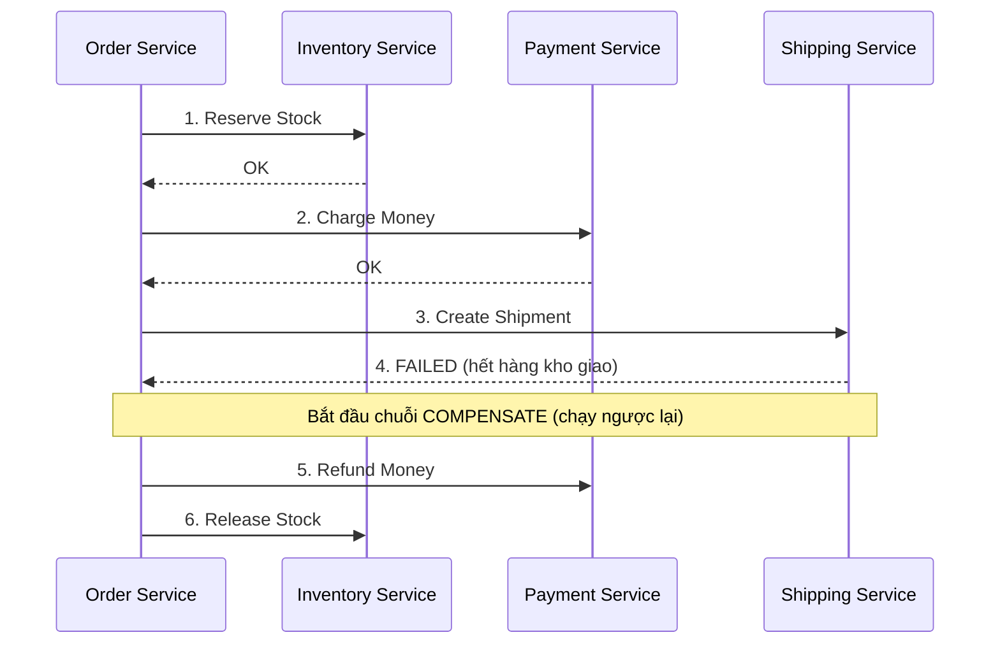

# 07 — Microservices: Khi 1 ứng dụng không còn đủ

---

## 1. Microservices giải quyết vấn đề gì — và cái giá phải trả

### 🧠 Ví dụ trước

Một hệ thống thương mại điện tử "Monolith" (1 ứng dụng duy nhất): module Order, Inventory, Payment, Shipping đều nằm chung 1 codebase, chung 1 database, deploy chung 1 lần.

- Team Shipping sửa 1 dòng code nhỏ → phải build & deploy **lại toàn bộ** ứng dụng, kể cả phần Payment không hề đụng tới → rủi ro cao, deploy chậm.
- Đợt sale lớn, module Order cần scale gấp 10 lần vì traffic tăng vọt, nhưng Payment chỉ cần gấp 2 → với Monolith, **buộc phải scale cả cụm** (tốn tài nguyên cho cả phần không cần scale).
- 50 developer cùng commit vào 1 codebase → xung đột merge liên tục, khó phân quyền rõ ràng theo team.

### 📌 Bản chất

**Microservices** tách ứng dụng thành nhiều service **độc lập**, mỗi service:
- Sở hữu **database riêng** (không service nào được đọc thẳng database của service khác).
- Deploy độc lập — sửa Shipping chỉ deploy lại Shipping.
- Scale độc lập — Order service có thể chạy 20 instance trong khi Payment chỉ cần 3.
- Thường do 1 team nhỏ sở hữu trọn vẹn (đúng tinh thần "you build it, you run it").

### ⚠️ Cái giá phải trả — đừng nhảy vào microservices chỉ vì "nghe oai"

| Vấn đề mới phát sinh | Trong Monolith (trước đây) |
|---|---|
| Gọi giữa các module giờ là gọi **qua mạng** (network call) — có thể fail, chậm, timeout | Gọi hàm trong cùng process — gần như không bao giờ fail vì lý do mạng |
| **Transaction** xuyên nhiều service **không thể** dùng 1 database transaction đơn giản nữa | 1 `SaveChanges()` trong 1 transaction là xong |
| Phải tự xây **Observability** (biết request nào lỗi, lỗi ở service nào trong chuỗi) | Debug 1 process bằng debugger thông thường là đủ |
| **Data duplication** — thông tin khách hàng có thể phải lưu ở cả Order service lẫn Shipping service (vì không join database trực tiếp được) | 1 bảng Customer, mọi module JOIN thẳng |

✅ **Quy tắc quyết định:** chỉ tách microservices khi tổ chức (team) đã đủ lớn để cần **tách quyền sở hữu** rõ ràng, hoặc có nhu cầu scale lệch nhau rõ rệt giữa các phần. Một startup nhỏ, 1 team 5 người, nên bắt đầu bằng **Monolith được tổ chức tốt theo Clean Architecture** (file 06) — dễ tách thành microservices sau này hơn là việc gộp microservices bị thiết kế sai thành 1 khối.

---

## 2. Giao tiếp giữa các Service

### 2.1. Đồng bộ (Synchronous) — REST / gRPC

```csharp
// Order service gọi thẳng Inventory service, CHỜ phản hồi mới đi tiếp
var available = await _inventoryClient.CheckStockAsync(productId, quantity);
if (!available) throw new OutOfStockException();
```

📌 Dùng khi cần **kết quả ngay lập tức** để quyết định bước tiếp theo (ví dụ: phải biết còn hàng hay không mới cho đặt đơn). **gRPC** (dùng HTTP/2 + Protocol Buffers) nhanh và nhẹ hơn REST/JSON đáng kể cho giao tiếp nội bộ giữa các service (không phải cho client public, vì ít trình duyệt hỗ trợ tốt).

⚠️ **Rủi ro:** nếu Order gọi Inventory, Inventory lại gọi Shipping, Shipping lại gọi tiếp service khác — chuỗi gọi đồng bộ càng dài, **xác suất lỗi cộng dồn càng cao** (nếu mỗi service có 99.9% uptime, chuỗi 5 service liên tiếp chỉ còn ~99.5% uptime tổng), và độ trễ (latency) cộng dồn theo từng bước chờ.

### 2.2. Bất đồng bộ (Asynchronous) — Message Queue / Event

```csharp
// Order service CHỈ publish 1 sự kiện, KHÔNG chờ ai xử lý xong
await _eventBus.PublishAsync(new OrderCreatedEvent(orderId, customerId, items));
// Order service coi như XONG VIỆC ngay tại đây, tiếp tục xử lý việc khác

// Inventory service, Shipping service... mỗi service TỰ LẮNG NGHE sự kiện này độc lập,
// xử lý theo tốc độ riêng của mình, không ai chờ ai
```

📌 Dùng message broker (RabbitMQ, Kafka, Azure Service Bus...) làm trung gian: service publish sự kiện lên "queue"/"topic", các service quan tâm tự subscribe và xử lý. Lợi ích: **giảm phụ thuộc trực tiếp (decoupling)** — Order service không cần biết Inventory hay Shipping tồn tại, không bị chặn lại nếu Inventory service đang chậm hoặc tạm chết (message vẫn nằm trong queue, chờ Inventory sống lại là xử lý tiếp).

✅ **Quy tắc chọn:** cần phản hồi ngay để quyết định luồng → đồng bộ (REST/gRPC). Chỉ cần "thông báo việc đã xảy ra" để các bên tự xử lý theo nhịp riêng, chấp nhận độ trễ xử lý (eventual consistency, nói ở mục 3) → bất đồng bộ (event/message).

---

## 3. Eventual Consistency & Saga Pattern — Transaction khi không còn 1 database chung

### 🧠 Ví dụ trước

Đặt 1 đơn hàng cần: (1) trừ tồn kho ở Inventory service, (2) trừ tiền ở Payment service, (3) tạo lệnh giao hàng ở Shipping service — **3 database khác nhau**, không thể dùng 1 `BEGIN TRANSACTION ... COMMIT` của SQL như trước. Nếu bước (2) thành công nhưng bước (3) thất bại, làm sao đảm bảo dữ liệu không bị "nửa vời" (đã trừ tiền nhưng không giao hàng)?

### 📌 Bản chất: Saga Pattern — chuỗi transaction cục bộ + bù trừ (compensation)



Thay vì 1 transaction lớn xuyên suốt, **Saga** chia thành chuỗi các transaction **cục bộ** (mỗi bước chỉ transaction trong 1 service), và nếu một bước giữa chừng thất bại, hệ thống chạy ngược lại các bước **bù trừ (compensating transaction)** để đưa dữ liệu về trạng thái nhất quán — ví dụ "hoàn tiền" để bù cho "đã charge tiền" khi bước sau đó thất bại. Đây gọi là **Eventual Consistency**: tại 1 thời điểm, dữ liệu giữa các service có thể tạm thời "chưa khớp nhau" (payment đã charge nhưng order chưa confirm), nhưng hệ thống **đảm bảo** cuối cùng (eventually) mọi thứ sẽ nhất quán — khác hẳn **Strong Consistency** quen thuộc của 1 database transaction đơn.

### 3.1. Outbox Pattern — tránh mất sự kiện khi service vừa ghi DB vừa publish message

### 🧠 Ví dụ trước (bẫy thường gặp)

```csharp
context.Orders.Add(order);
await context.SaveChangesAsync();          // (1) ghi DB thành công

await _eventBus.PublishAsync(new OrderCreatedEvent(order.Id)); // (2) publish message
// ⚠️ NẾU SERVICE CRASH giữa bước (1) và (2) — đơn hàng đã lưu DB,
// nhưng message KHÔNG BAO GIỜ được gửi → Inventory/Shipping KHÔNG BAO GIỜ biết có đơn hàng này!
```

### 📌 Giải pháp

```csharp
using var transaction = context.Database.BeginTransaction();
context.Orders.Add(order);
context.OutboxMessages.Add(new OutboxMessage         // lưu message vào CHÍNH bảng, CÙNG transaction
{
    Payload = JsonSerializer.Serialize(new OrderCreatedEvent(order.Id)),
    IsProcessed = false
});
await context.SaveChangesAsync();   // (1) và (2) giờ CÙNG 1 transaction — cùng thành công hoặc cùng fail
transaction.Commit();

// Một tiến trình nền (background worker) riêng, định kỳ:
// đọc OutboxMessages chưa xử lý → publish lên message broker → đánh dấu IsProcessed = true
```

✅ **Outbox Pattern**: ghi message cần gửi vào **chính bảng trong cùng database, cùng transaction** với nghiệp vụ chính — đảm bảo "ghi dữ liệu" và "chuẩn bị gửi sự kiện" là **1 hành động nguyên tử** (atomic, nhờ cùng transaction của chính database đó, không cần 2-phase commit phức tạp xuyên hệ thống). Một tiến trình nền riêng biệt sẽ đọc bảng Outbox và publish thật sự lên message broker sau đó, có thể retry an toàn nếu publish lần đầu thất bại (vì message vẫn còn nằm trong bảng, chưa đánh dấu `IsProcessed`).

---

## 4. API Gateway — cửa ngõ duy nhất cho client

### 🧠 Ví dụ trước

Không có Gateway: ứng dụng mobile phải tự biết địa chỉ của **từng** service (Order ở domain A, Inventory ở domain B...), tự xử lý authentication riêng cho từng cuộc gọi, tự chịu N round-trip nếu 1 màn hình cần dữ liệu từ 3 service khác nhau.

### 📌 Bản chất

**API Gateway** là 1 lớp trung gian duy nhất mà client (web/mobile) gọi vào, Gateway lo:
- **Routing**: biết request nào cần chuyển tới service nào.
- **Authentication/Authorization tập trung**: xác thực 1 lần tại Gateway, không lặp lại logic này ở từng service.
- **Aggregation**: gộp dữ liệu từ nhiều service thành 1 response cho client (gọi là **Backend For Frontend - BFF** khi Gateway được thiết kế riêng theo nhu cầu từng loại client).
- **Rate limiting, caching chung** ở 1 điểm thay vì lặp lại ở mọi service.

✅ Lợi ích lớn nhất: client chỉ cần biết **1 địa chỉ duy nhất**, không cần quan tâm hệ thống phía sau có bao nhiêu service hay chúng tổ chức thế nào — đúng tinh thần đóng gói (encapsulation) ở quy mô hệ thống.

---

## 5. Resilience — xử lý khi service khác bị lỗi/chậm

### 🧠 Ví dụ trước

Inventory service đột nhiên chậm (do quá tải). Order service gọi tới, chờ mãi không timeout → các request khác của Order service cũng bị nghẽn theo (hết thread/connection pool chờ Inventory) → Order service "sập dây chuyền" theo dù chính nó không hề có lỗi gì. Đây gọi là **cascading failure**.

### 📌 Circuit Breaker Pattern (thường dùng thư viện Polly trong .NET)

```csharp
var pipeline = new ResiliencePipelineBuilder()
    .AddRetry(new RetryStrategyOptions { MaxRetryAttempts = 3 })       // thử lại vài lần nếu lỗi tạm thời
    .AddCircuitBreaker(new CircuitBreakerStrategyOptions               // "ngắt mạch" nếu lỗi liên tục
    {
        FailureRatio = 0.5,
        MinimumThroughput = 10,
        BreakDuration = TimeSpan.FromSeconds(30)
    })
    .AddTimeout(TimeSpan.FromSeconds(5))                                // không chờ vô hạn
    .Build();

var result = await pipeline.ExecuteAsync(async ct => await _inventoryClient.CheckStockAsync(productId, ct));
```

📌 Giống cầu dao điện thật: nếu Inventory service lỗi liên tục vượt ngưỡng (ví dụ quá 50% request thất bại), Circuit Breaker **"ngắt mạch"** — trong khoảng thời gian tới (ví dụ 30 giây), Order service **không gọi thật** tới Inventory nữa (trả lỗi ngay lập tức, cực nhanh, không chờ timeout), cho Inventory service **thời gian hồi phục** thay vì bị dội thêm request trong lúc đang quá tải. Sau thời gian đó, circuit "thử" cho 1 request đi qua xem Inventory đã khỏe chưa, rồi quyết định đóng lại mạch hoàn toàn hay tiếp tục ngắt.

✅ Kết hợp **Retry** (thử lại khi lỗi thoáng qua, tạm thời) + **Circuit Breaker** (ngừng hẳn khi lỗi kéo dài, tránh làm tình hình tệ hơn) + **Timeout** (không bao giờ chờ vô thời hạn) là bộ 3 tối thiểu cần có cho mọi cuộc gọi giữa các service trong production.

---

## 6. Observability — "nhìn thấy" hệ thống phân tán

### 🧠 Ví dụ trước

User báo "đặt hàng bị lỗi". Trong Monolith, mở 1 log file, tìm theo thời gian là thấy ngay stack trace. Trong Microservices, request đó đã đi qua Gateway → Order service → Inventory service → Payment service — lỗi xảy ra ở service nào? Log nằm rải rác ở 4-5 server khác nhau, timestamp không đồng bộ tuyệt đối — tìm bằng tay gần như bất khả thi.

### 📌 Ba trụ cột của Observability

| Trụ cột | Trả lời câu hỏi | Công cụ phổ biến |
|---|---|---|
| **Logging** | "Chuyện gì đã xảy ra, chi tiết thế nào" | Serilog/Seq, ELK Stack |
| **Metrics** | "Hệ thống đang khỏe hay yếu, theo con số" (CPU, request/giây, tỉ lệ lỗi) | Prometheus + Grafana |
| **Distributed Tracing** | "Request này đi qua những service nào, tốn bao lâu ở mỗi chặng" | OpenTelemetry, Jaeger, Zipkin |

### 📌 Correlation ID — sợi chỉ xuyên suốt 1 request

```csharp
// Mỗi request đi vào hệ thống được gắn 1 ID duy nhất ngay từ Gateway,
// và ID này được TRUYỀN KÈM qua mọi cuộc gọi service-to-service tiếp theo (qua HTTP header)
app.Use(async (context, next) =>
{
    var correlationId = context.Request.Headers["X-Correlation-ID"].FirstOrDefault()
                         ?? Guid.NewGuid().ToString();
    using (LogContext.PushProperty("CorrelationId", correlationId)) // mọi dòng log tự động kèm ID này
    {
        await next();
    }
});
```

✅ Khi debug, chỉ cần lọc log theo 1 `CorrelationId` ở hệ thống log tập trung (đã gộp log từ mọi service về 1 chỗ), là thấy được **toàn bộ hành trình** của request đó qua mọi service, theo đúng thứ tự thời gian — đây là công cụ sống còn khi vận hành microservices thực tế, không có nó thì gần như "mù" khi có sự cố.

---

## 7. Tóm tắt chương

| Khái niệm | Ghi nhớ cốt lõi |
|---|---|
| Microservices | Đổi lấy tính độc lập (deploy/scale/team) bằng độ phức tạp vận hành — không nhảy vào khi chưa cần |
| Sync (REST/gRPC) vs Async (Message) | Cần kết quả ngay → sync; chỉ cần báo sự kiện, các bên tự xử lý → async |
| Eventual Consistency | Dữ liệu giữa các service có thể tạm "lệch nhau", nhưng đảm bảo cuối cùng sẽ khớp |
| Saga Pattern | Chuỗi transaction cục bộ + bước bù trừ (compensation) khi 1 bước giữa chừng thất bại |
| Outbox Pattern | Ghi message cần gửi vào cùng transaction với nghiệp vụ chính, tránh mất message khi crash |
| API Gateway | 1 cửa ngõ duy nhất cho client — routing, auth tập trung, gộp dữ liệu nhiều service |
| Circuit Breaker | Ngừng gọi service đang lỗi nặng, tránh cascading failure, cho nó thời gian hồi phục |
| Observability | Logging + Metrics + Distributed Tracing, nối bằng Correlation ID xuyên suốt request |

---

➡️ Đã hoàn thành lộ trình từ nền tảng ngôn ngữ (file 01-03) → nền tảng ứng dụng (file 04-05) → kiến trúc hệ thống (file 06-07). Quay lại [00-README.md](00-README.md) để xem toàn bộ lộ trình.
