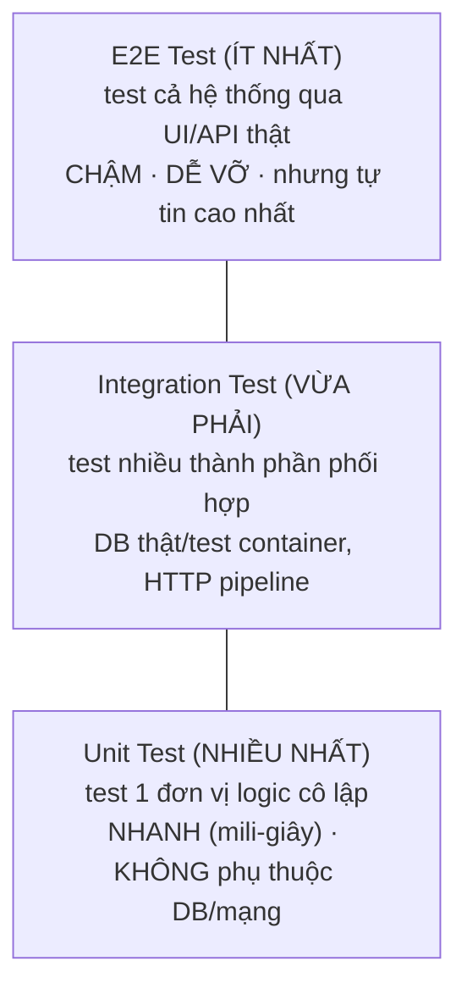

# 09 — Unit Testing & TDD: Viết test có giá trị thật sự

> Viết test không phải để "có coverage cho đẹp báo cáo". Một bộ test tốt là **bộ test giúp bạn sửa code tự tin** mà không sợ phá vỡ thứ gì đó ở chỗ khác — nếu test của bạn không cho bạn cảm giác đó, nó chưa đạt mục đích.

---

## 1. Test Pyramid — không phải loại test nào cũng nên viết nhiều như nhau

### 🧠 Ví dụ trước

Một dự án có 500 test, nhưng **toàn bộ đều là integration test** chạy thật với database — mỗi lần CI chạy mất 40 phút, dev ngại chạy test trước khi commit, test hay bị "flaky" (lúc pass lúc fail) vì phụ thuộc trạng thái database.

### 📌 Bản chất



✅ **Quy tắc:** phần lớn test nên là **Unit Test** — nhanh (chạy hàng ngàn test trong vài giây), ổn định (không phụ thuộc trạng thái bên ngoài), giúp dev chạy liên tục khi code. Integration test dùng để xác nhận các thành phần **ghép lại với nhau** đúng (ví dụ: EF Core query có thực sự dịch đúng ra SQL mong muốn không). E2E test chỉ nên bao phủ **vài luồng nghiệp vụ quan trọng nhất** (checkout, đăng nhập) vì chi phí duy trì rất cao.

---

## 2. Cấu trúc 1 test tốt: Arrange — Act — Assert (AAA)

### 🧠 Ví dụ trước

```csharp
public class OrderTests
{
    [Fact]
    public void Order_WithNoItems_ShouldThrowDomainException()
    {
        // Arrange — chuẩn bị dữ liệu đầu vào, trạng thái ban đầu
        var customerId = Guid.NewGuid();
        var emptyItems = new List<OrderItem>();

        // Act — thực hiện đúng 1 hành động đang muốn kiểm tra
        var act = () => new Order(customerId, emptyItems);

        // Assert — kiểm chứng kết quả đúng như kỳ vọng
        Assert.Throws<DomainException>(act);
    }
}
```

📌 **Tên test là tài liệu sống**: `Order_WithNoItems_ShouldThrowDomainException` tự nó mô tả rõ: đối tượng test (`Order`), điều kiện (`WithNoItems`), kỳ vọng (`ShouldThrowDomainException`). Khi test này fail trong tương lai, chỉ cần đọc tên là hiểu ngay đang kiểm tra quy tắc nghiệp vụ nào, không cần đọc cả thân hàm.

✅ **Quy tắc vàng:** mỗi test chỉ nên **Act đúng 1 lần**, kiểm tra **đúng 1 hành vi**. Test kiểm tra nhiều thứ cùng lúc sẽ khó biết chính xác cái gì bị hỏng khi nó fail, và dễ vỡ (fragile) mỗi khi logic liên quan thay đổi dù không liên quan tới điều bạn thật sự muốn test.

---

## 3. Test Double: Mock, Stub, Fake — phân biệt để dùng đúng chỗ

### 🧠 Ví dụ trước

```csharp
public class CreateOrderHandlerTests
{
    [Fact]
    public async Task Handle_ValidCommand_ShouldSaveOrderAndSendEmail()
    {
        // Arrange
        var mockRepo = new Mock<IOrderRepository>();
        var mockEmail = new Mock<IEmailSender>();
        var handler = new CreateOrderHandler(mockRepo.Object, mockEmail.Object);

        var command = new CreateOrderCommand(Guid.NewGuid(), new List<OrderItemDto> { new(1, 2) });

        // Act
        await handler.Handle(command, CancellationToken.None);

        // Assert — kiểm tra ĐÃ GỌI đúng phương thức với đúng tham số, không cần DB thật
        mockRepo.Verify(r => r.Save(It.Is<Order>(o => o.CustomerId == command.CustomerId)), Times.Once);
        mockEmail.Verify(e => e.SendAsync(It.IsAny<string>(), It.IsAny<string>()), Times.Once);
    }
}
```

### 📌 Phân biệt 3 loại "test double" hay bị gọi lẫn lộn là "mock"

| Loại | Bản chất | Dùng khi |
|---|---|---|
| **Stub** | Trả về giá trị **cố định sẵn**, không quan tâm có bị gọi hay không, gọi bao nhiêu lần | Chỉ cần cung cấp dữ liệu đầu vào giả để code chạy được (`mockRepo.Setup(r => r.GetById(1)).Returns(someOrder)`) |
| **Mock** | Giống Stub, nhưng còn dùng để **kiểm tra hành vi** — có bị gọi đúng không, đúng bao nhiêu lần, với tham số gì (`mockEmail.Verify(...)`) | Khi điều bạn thật sự muốn kiểm chứng là "method X có được gọi đúng cách không", không phải giá trị trả về |
| **Fake** | Một bản triển khai **thật sự hoạt động** nhưng đơn giản hóa (ví dụ: `InMemoryOrderRepository` dùng `Dictionary` thay vì SQL thật) | Khi logic test cần tương tác qua lại nhiều bước với dữ liệu, dùng Mock sẽ phải setup quá phức tạp |

⚠️ **Lạm dụng Mock là dấu hiệu thiết kế có vấn đề**: nếu 1 test cần mock tới 6-7 dependency mới chạy được, thường nghĩa là class đang test đang làm **quá nhiều việc** (vi phạm Single Responsibility Principle) — nên cân nhắc tách nhỏ class đó ra trước, thay vì cố viết test phức tạp hơn để "ôm" hết.

---

## 4. Test gì, không test gì

### ✅ Nên tập trung test (giá trị cao)

- **Domain & Application layer** (file 06): business rule, validation, các nhánh điều kiện phức tạp — đây là nơi logic nghiệp vụ thật sự sống, và là nơi lỗi gây hậu quả nghiêm trọng nhất nếu sai.
- **Edge case**: input rỗng, số âm, null, giá trị biên (0, max value), không chỉ test "happy path" (trường hợp mọi thứ đều đúng).

### ⚠️ Không cần test (giá trị thấp, lãng phí công sức)

```csharp
// ⚠️ Test kiểu này gần như VÔ NGHĨA — chỉ lặp lại chính code, không bắt được lỗi logic thật nào
[Fact]
public void GetName_ShouldReturnName()
{
    var person = new Person { Name = "An" };
    Assert.Equal("An", person.Name); // đang test... auto-property của C#, không test logic gì cả
}
```

- Code của chính framework/thư viện (EF Core, ASP.NET Core đã có team riêng test kỹ).
- Property/field đơn giản không có logic gì bên trong (auto-property get/set).
- Infrastructure code gọi thẳng SDK bên thứ 3 (nên test bằng integration test thật, hoặc tin tưởng SDK đó, không cố mock quá chi tiết cách SDK hoạt động bên trong).

---

## 5. TDD — Red, Green, Refactor

### 📌 Chu trình

```
1. RED     — viết test TRƯỚC, cho use case CHƯA TỒN TẠI → chạy test, chắc chắn FAIL (vì code chưa có)
2. GREEN   — viết code TỐI THIỂU vừa đủ để test PASS, không cần đẹp, không cần tối ưu
3. REFACTOR— dọn dẹp code lại cho sạch, rõ ràng — TEST VẪN PHẢI PASS trong suốt bước này
                 → lặp lại từ bước 1 cho hành vi tiếp theo
```

### 🧠 Ví dụ trước — áp dụng cho rule "đơn hàng cần ≥1 sản phẩm" (file 06)

```csharp
// BƯỚC 1 (RED): viết test này TRƯỚC khi class Order có logic kiểm tra
[Fact]
public void Order_WithNoItems_ShouldThrowDomainException()
{
    Assert.Throws<DomainException>(() => new Order(Guid.NewGuid(), new List<OrderItem>()));
}
// Chạy test → FAIL vì Order chưa hề kiểm tra gì (hoặc chưa có constructor này)

// BƯỚC 2 (GREEN): viết VỪA ĐỦ code để pass
public class Order
{
    public Order(Guid customerId, List<OrderItem> items)
    {
        if (items.Count == 0) throw new DomainException("Đơn hàng phải có ít nhất 1 sản phẩm");
        // ...
    }
}
// Chạy test → PASS

// BƯỚC 3 (REFACTOR): nếu cần dọn code đẹp hơn, test vẫn phải xanh suốt quá trình
```

✅ **Lợi ích thật sự của TDD** không nằm ở việc "viết test trước" như một nghi thức, mà ở chỗ: nó **ép bạn nghĩ rõ về behavior/hợp đồng** (contract) của đoạn code **trước khi** viết implementation, và đảm bảo **mọi dòng code đều có ít nhất 1 lý do tồn tại** (được viết ra chỉ để làm 1 test cụ thể pass) — giảm hẳn code thừa không ai dùng tới.

⚠️ TDD không bắt buộc áp dụng 100% mọi dòng code (ví dụ: code UI thuần hiển thị, code thử nghiệm/spike ban đầu) — áp dụng mạnh nhất ở nơi có **logic nghiệp vụ phức tạp, nhiều nhánh điều kiện**, nơi giá trị của việc "nghĩ kỹ trước khi viết" là cao nhất.

---

## 6. Testing Async code & FluentAssertions (tiện ích thường dùng)

```csharp
[Fact]
public async Task GetOrderAsync_WhenNotFound_ShouldReturnNull()
{
    var repo = new Mock<IOrderRepository>();
    repo.Setup(r => r.GetByIdAsync(It.IsAny<Guid>())).ReturnsAsync((Order?)null);

    var result = await _service.GetOrderAsync(Guid.NewGuid());

    result.Should().BeNull(); // FluentAssertions: đọc gần như tiếng Anh tự nhiên, thông báo lỗi rõ ràng hơn Assert.Equal
}
```

📌 Test method async **phải** khai báo `async Task` (không phải `async void`) — nếu không, test framework **không chờ được** tác vụ async hoàn thành trước khi kết thúc test, dẫn tới test luôn "pass giả" dù code bên trong thực chất bị lỗi (exception trong `async void` không được test runner bắt lại được, giống như đã nói ở file 03 về nguy cơ của `async void`).

---

## 7. Tóm tắt chương

| Khái niệm | Ghi nhớ cốt lõi |
|---|---|
| Test Pyramid | Nhiều Unit Test (nhanh, ổn định), ít Integration/E2E Test (chậm, dễ vỡ, nhưng tự tin cao) |
| AAA Pattern | Arrange-Act-Assert, mỗi test chỉ Act 1 hành động, kiểm 1 hành vi |
| Stub vs Mock vs Fake | Trả dữ liệu giả / kiểm tra có bị gọi đúng không / bản triển khai đơn giản hoạt động thật |
| Lạm dụng Mock | Dấu hiệu class đang test vi phạm Single Responsibility — nên tách nhỏ |
| Nên test gì | Domain/Application logic, edge case — KHÔNG test code framework hay property trơn |
| TDD | Red (test fail) → Green (code vừa đủ pass) → Refactor (dọn code, test vẫn xanh) |
| async Task test | Luôn `async Task`, không bao giờ `async void`, để test runner chờ và bắt được lỗi đúng |

➡️ Tiếp theo: [10-SignalR-Realtime.md](10-SignalR-Realtime.md) — giao tiếp real-time giữa server và client.
