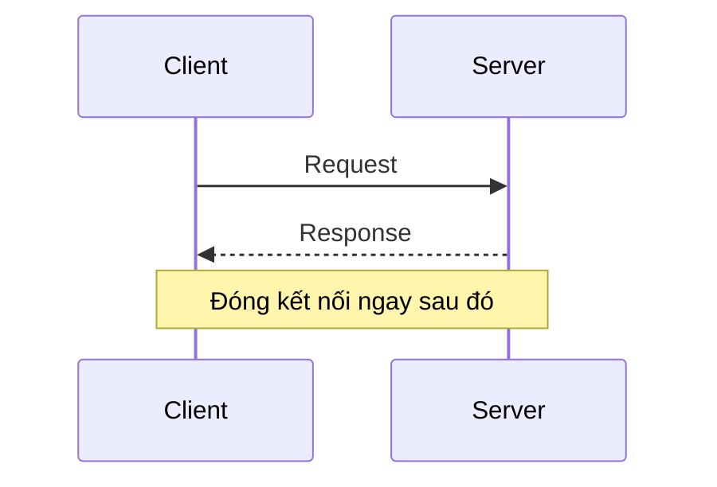
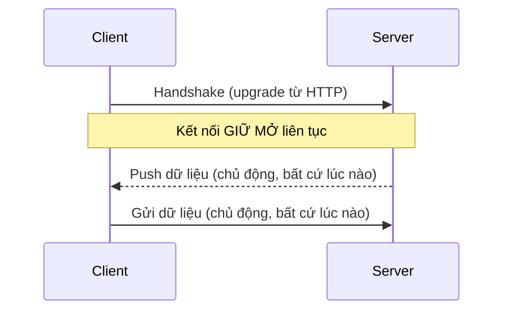

# 10 — SignalR & Real-time Communication

---

## 1. Vấn đề cần giải quyết: HTTP vốn không phải để "đẩy" dữ liệu

### 🧠 Ví dụ trước

Bạn muốn hiển thị thông báo "có đơn hàng mới" ngay lập tức cho nhân viên bán hàng, không cần họ bấm F5. Với HTTP thông thường, **server không bao giờ tự gọi được cho client** — client luôn phải là người **chủ động hỏi trước** (request), server chỉ trả lời (response). Giải pháp "thô" là **Polling**: client cứ mỗi 3 giây gọi 1 lần hỏi "có gì mới không?" — tốn tài nguyên (hầu hết các lần hỏi đều "không có gì mới"), và vẫn có độ trễ tới 3 giây.

### 📌 Bản chất: WebSocket — kết nối 2 chiều, giữ mở liên tục

**HTTP thông thường — client luôn phải hỏi trước:**



**WebSocket — kết nối giữ mở, cả 2 bên đều chủ động gửi được:**



**WebSocket** là 1 giao thức (bắt đầu bằng 1 cú "bắt tay" qua HTTP, rồi nâng cấp — *upgrade* — thành kết nối 2 chiều riêng) cho phép **server chủ động gửi dữ liệu xuống client** bất cứ lúc nào, không cần client hỏi trước. Đây chính là nền tảng để làm chat real-time, thông báo đẩy, dashboard cập nhật trực tiếp.

### 📌 SignalR là gì — không phải "thay thế WebSocket", mà là lớp trừu tượng bọc quanh nó

**SignalR** là thư viện của ASP.NET Core giúp lập trình real-time **mà không cần tự quản lý WebSocket thủ công**. Nó tự động chọn giao thức vận chuyển (transport) tốt nhất có sẵn, theo thứ tự ưu tiên:

1. **WebSocket** (tốt nhất — 2 chiều thật sự, nếu trình duyệt/mạng hỗ trợ)
2. **Server-Sent Events (SSE)** (chỉ 1 chiều server → client, dùng khi WebSocket bị chặn)
3. **Long Polling** (phương án cuối cùng — client hỏi, server **giữ request đó mở** tới khi có dữ liệu mới mới trả lời, rồi client hỏi lại ngay — ít tốn hơn polling thường vì không hỏi dồn dập)

✅ Lợi ích lớn nhất: bạn code **1 API duy nhất** (gọi method, nhận method), SignalR tự lo phần hạ tầng mạng bên dưới, tự fallback khi môi trường client (proxy công ty, firewall...) chặn WebSocket.

---

## 2. Hub — trung tâm điều phối của SignalR

### 🧠 Ví dụ trước

```csharp
public class NotificationHub : Hub
{
    public async Task SendNotification(string userId, string message)
    {
        // "Clients" là tập hợp mọi client đang kết nối tới Hub này
        await Clients.User(userId).SendAsync("ReceiveNotification", message);
    }

    public override async Task OnConnectedAsync()
    {
        Console.WriteLine($"Client kết nối: {Context.ConnectionId}");
        await base.OnConnectedAsync();
    }
}
```

```csharp
// Program.cs
builder.Services.AddSignalR();
app.MapHub<NotificationHub>("/hubs/notification");
```

```javascript
// Phía client (JavaScript)
const connection = new signalR.HubConnectionBuilder()
    .withUrl("/hubs/notification")
    .withAutomaticReconnect() // tự động kết nối lại nếu mạng chập chờn
    .build();

connection.on("ReceiveNotification", (message) => {
    console.log("Nhận được: " + message);
});

await connection.start();
```

### 📌 Bản chất

`Hub` là 1 class đặc biệt mà cả server và client đều có thể **gọi method lẫn nhau theo tên**, giống như Remote Procedure Call (RPC): server gọi `Clients.User(userId).SendAsync("ReceiveNotification", message)` thực chất là gửi 1 message bảo client "hãy chạy hàm JavaScript tên `ReceiveNotification` với tham số `message`" — không phải gọi hàm C# thật sự xuyên qua mạng, mà là 1 giao thức nhắn tin có cấu trúc (dựa trên JSON hoặc MessagePack) được SignalR tự đóng gói/giải mã ở cả 2 đầu.

### 2.1. Gửi cho ai — Groups, Users, All

```csharp
await Clients.All.SendAsync("Method", data);                  // mọi client đang kết nối
await Clients.Caller.SendAsync("Method", data);                // chỉ người vừa gọi lên server
await Clients.User(userId).SendAsync("Method", data);          // 1 user cụ thể (có thể có nhiều kết nối — nhiều tab/thiết bị)
await Clients.Group("Room-A").SendAsync("Method", data);       // mọi client trong 1 "nhóm" tự định nghĩa

await Groups.AddToGroupAsync(Context.ConnectionId, "Room-A");  // thêm connection hiện tại vào group
```

✅ **Group** là khái niệm logic do bạn tự định nghĩa (ví dụ: 1 group cho mỗi phòng chat, mỗi dashboard theo phòng ban) — không có sẵn trong WebSocket thuần, SignalR cung cấp sẵn để tổ chức việc "gửi cho ai" dễ dàng hơn nhiều so với tự quản lý danh sách connection tay.

---

## 3. Scale-out: Backplane — vì sao 1 instance không đủ khi deploy nhiều server

### 🧠 Ví dụ trước (vấn đề thực tế khi lên production)

Ứng dụng chạy **2 instance** (load balancer phân tải). User A kết nối WebSocket vào Instance 1. User B (gửi thông báo cho A) lại có HTTP request được load balancer đưa vào Instance 2. Instance 2 gọi `Clients.User(A).SendAsync(...)`, nhưng **User A không hề có kết nối nào tới Instance 2** → thông báo **không bao giờ tới được** User A.

### 📌 Giải pháp: Backplane (thường dùng Redis)

```csharp
builder.Services.AddSignalR().AddStackExchangeRedis("localhost:6379");
```

📌 **Backplane** là 1 kênh trung gian (thường là Redis Pub/Sub) mà **mọi instance** SignalR đều kết nối vào. Khi Instance 2 gọi `SendAsync`, thay vì chỉ tìm trong danh sách connection cục bộ của chính nó, nó **publish message lên Redis**; Redis **phát (broadcast) message đó tới tất cả instance** đang subscribe (bao gồm Instance 1); Instance 1 nhận được, thấy User A đang kết nối với mình, mới thực sự đẩy message xuống qua WebSocket của A.

✅ **Quy tắc:** bất kỳ khi nào deploy SignalR trên **nhiều hơn 1 instance** (gần như chắc chắn xảy ra trong production thật, vì cần scale/high-availability), **bắt buộc** phải cấu hình Backplane — nếu không, hành vi sẽ "lúc được lúc không" tùy user đó đang kết nối vào instance nào, cực kỳ khó debug nếu không biết trước nguyên nhân này.

---

## 4. Khi nào dùng SignalR, khi nào không

✅ **Phù hợp:** chat, thông báo đẩy, dashboard cập nhật số liệu trực tiếp, theo dõi tiến trình xử lý dài (progress bar của 1 tác vụ chạy nền), tính năng "ai đang online", collaborative editing (nhiều người cùng sửa 1 tài liệu).

⚠️ **Không phù hợp:**
- Giao tiếp giữa các **microservices** với nhau (file 07) — dùng message broker (RabbitMQ/Kafka) hoặc gRPC, SignalR sinh ra cho giao tiếp **server ↔ trình duyệt/app di động**, không phải service-to-service.
- Dữ liệu không cần "ngay lập tức" — polling định kỳ dài (vài phút) hoặc dùng webhook vẫn đơn giản và đủ dùng, không cần giữ kết nối liên tục tốn tài nguyên server.

---

## 5. Tóm tắt chương

| Khái niệm | Ghi nhớ cốt lõi |
|---|---|
| WebSocket | Kết nối 2 chiều giữ mở — server chủ động gửi được xuống client, không cần client hỏi trước |
| SignalR | Lớp trừu tượng bọc WebSocket/SSE/Long Polling, tự chọn transport tốt nhất, tự fallback |
| Hub | Nơi server/client gọi method lẫn nhau theo tên, như RPC qua message JSON/MessagePack |
| Group | Khái niệm logic tự định nghĩa để gửi message cho 1 tập client cụ thể |
| Backplane (Redis) | Bắt buộc khi deploy nhiều instance — đồng bộ message giữa các instance để đúng người nhận được |

➡️ Tiếp theo: [11-Security-AuthN-AuthZ.md](11-Security-AuthN-AuthZ.md) — xác thực và phân quyền trong ASP.NET Core.
