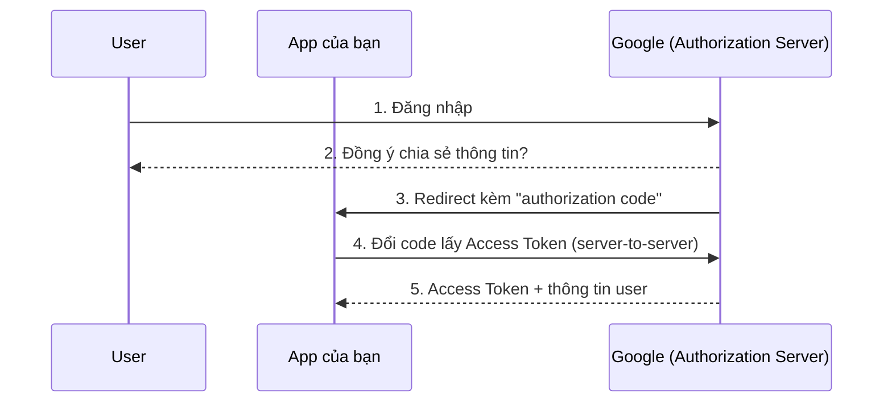

# 11 — Security: Authentication & Authorization trong ASP.NET Core

---

## 1. Authentication vs Authorization — 2 câu hỏi hoàn toàn khác nhau

### 🧠 Ví dụ trước

Bạn vào công ty: bảo vệ kiểm tra thẻ nhân viên để biết **bạn là ai** — đó là **Authentication (AuthN)**. Sau khi vào trong, bạn quẹt thẻ ở cửa phòng server nhưng bị từ chối vì phòng ban bạn không có quyền vào đó — đó là **Authorization (AuthZ)**. Biết "bạn là ai" không đồng nghĩa "bạn được làm gì".

### 📌 Trong ASP.NET Core

```csharp
app.UseAuthentication(); // xác định "ai đang gọi request này" → tạo ra ClaimsPrincipal (User)
app.UseAuthorization();  // kiểm tra "User này có được phép làm việc đang yêu cầu không"
```

⚠️ Như đã nói ở file 04: thứ tự 2 middleware này **bắt buộc** đúng — `UseAuthentication` luôn trước `UseAuthorization`, vì không thể kiểm tra quyền của 1 người chưa xác định được danh tính.

---

## 2. Claims-based Identity — đơn vị thông tin cơ bản nhất

### 🧠 Ví dụ trước

```csharp
[Authorize]
[HttpGet("profile")]
public IActionResult GetProfile()
{
    string? userId = User.FindFirst(ClaimTypes.NameIdentifier)?.Value;
    string? email = User.FindFirst(ClaimTypes.Email)?.Value;
    bool isAdmin = User.IsInRole("Admin");
    return Ok(new { userId, email });
}
```

### 📌 Bản chất

Sau khi xác thực thành công, ASP.NET Core dựng lên 1 object `ClaimsPrincipal` (truy cập qua `User`) — đây là tập hợp các **Claim**, mỗi claim là 1 cặp (loại thông tin, giá trị): `("name", "Nguyễn Văn A")`, `("role", "Admin")`, `("email", "a@mail.com")`... Toàn bộ hệ thống Authorization của .NET (role, policy) đều xây dựng **trên nền** các claim này — không quan tâm claim đó tới từ cookie, JWT, hay bất kỳ cơ chế xác thực nào, miễn là `ClaimsPrincipal` được dựng đúng.

---

## 3. JWT (JSON Web Token) — cơ chế xác thực phổ biến nhất cho API

### 🧠 Ví dụ trước

```
eyJhbGciOiJIUzI1NiJ9.eyJzdWIiOiIxMjMiLCJyb2xlIjoiQWRtaW4ifQ.4Q7X9z...
```

| Phần | Giá trị ví dụ | Chứa gì |
|---|---|---|
| **Header** | `eyJhbGciOiJIUzI1NiJ9` | Thuật toán ký, ví dụ `HS256` |
| **Payload** | `eyJzdWIiOiIxMjMiLCJyb2xlIjoiQWRtaW4ifQ` | Các claim: `sub` (user id), `role`, `exp`... |
| **Signature** | `4Q7X9z...` | Chữ ký điện tử — chống giả mạo, KHÔNG che giấu nội dung |

Dán đoạn `eyJzdWIiOiIxMjMiLCJyb2xlIjoiQWRtaW4ifQ` vào [jwt.io](https://jwt.io), bạn sẽ thấy nó giải mã ra ngay thành `{"sub": "123", "role": "Admin"}` — **đọc được dễ dàng**, không hề mã hóa.

### 📌 Bản chất: JWT bảo vệ tính **toàn vẹn (integrity)**, không bảo vệ tính **bí mật (confidentiality)**

JWT gồm 3 phần, nối bằng dấu chấm, mỗi phần chỉ là **Base64-encode** (không phải mã hóa — mã hóa là 2 chiều có thể giải mã, encode chỉ là đổi định dạng biểu diễn, ai cũng decode đọc được):

1. **Header**: thuật toán ký (`HS256`, `RS256`...)
2. **Payload**: các claim (`sub` = user id, `role`, `exp` = thời điểm hết hạn...)
3. **Signature**: chữ ký điện tử, tính từ Header + Payload + 1 **secret key** mà chỉ server biết.

⚠️ **Hiểu lầm nguy hiểm nhất**: vì ai cũng đọc được payload (chỉ là Base64), **tuyệt đối không được nhét thông tin nhạy cảm** (mật khẩu, số thẻ, dữ liệu riêng tư) vào payload của JWT. Giá trị bảo mật của JWT nằm ở **Signature**: nếu ai đó cố sửa payload (ví dụ đổi `"role": "User"` thành `"role": "Admin"`), signature tính lại sẽ **không khớp** với signature gốc (vì không biết secret key của server) → server kiểm tra thấy sai lệch, từ chối token ngay. Đây gọi là **tamper-proof** (chống giả mạo), không phải **bí mật**.

### 📌 Vì sao JWT phù hợp cho API — Stateless Authentication

```
Cách cũ (Session/Cookie truyền thống):          Cách JWT (Stateless):
Server phải LƯU session ở đâu đó (RAM/Redis)      Server KHÔNG cần lưu gì cả — mọi thông tin
→ mỗi request phải tra cứu session đó              cần thiết đã NẰM SẴN trong chính token
→ khó scale ngang (nhiều server phải                → server chỉ cần verify chữ ký, không cần
  dùng chung nơi lưu session)                          tra cứu database/cache gì thêm
```

✅ JWT giúp server **không cần giữ trạng thái (stateless)** — rất phù hợp cho API được gọi từ nhiều loại client (web, mobile) và hệ thống cần scale ngang nhiều instance (nhớ lại file 07 — không cần "sticky session" hay backplane như SignalR).

### 3.1. `[Authorize]` kiểm tra JWT thế nào

```csharp
builder.Services.AddAuthentication(JwtBearerDefaults.AuthenticationScheme)
    .AddJwtBearer(options =>
    {
        options.TokenValidationParameters = new TokenValidationParameters
        {
            ValidateIssuerSigningKey = true,
            IssuerSigningKey = new SymmetricSecurityKey(Encoding.UTF8.GetBytes(secretKey)), // secret key để verify Signature
            ValidateLifetime = true, // tự động từ chối nếu "exp" đã quá hạn
        };
    });
```

Mỗi request có header `Authorization: Bearer <token>`, middleware `UseAuthentication` sẽ: (1) tách token ra, (2) **tính lại signature** bằng chính `secretKey` của server và so sánh với signature trong token, (3) nếu khớp và chưa hết hạn → dựng `ClaimsPrincipal` từ payload, request được coi là "đã xác thực".

### 3.2. Refresh Token — vì sao JWT access token nên sống ngắn

⚠️ Vì JWT là stateless (server không lưu danh sách token đã cấp), **không có cách nào "thu hồi" (revoke) 1 JWT đã phát hành** trước khi nó hết hạn tự nhiên — nếu lỡ token bị lộ, kẻ xấu dùng được tới tận lúc token đó hết hạn. Giải pháp thực tế:

- **Access Token**: sống **ngắn** (5-15 phút) — dùng để gọi API, nếu bị lộ thì thiệt hại cũng chỉ trong khoảng thời gian ngắn đó.
- **Refresh Token**: sống **dài** (vài ngày/tuần), nhưng được **lưu lại trong database** (có thể thu hồi chủ động bất cứ lúc nào bằng cách xóa record trong DB) — dùng để "đổi lấy" Access Token mới khi cái cũ hết hạn, mà không bắt user đăng nhập lại liên tục.

### 3.3. ⚠️ Lưu JWT ở đâu phía client — bẫy bảo mật phổ biến

```javascript
localStorage.setItem("token", jwt); // ⚠️ RỦI RO: nếu site bị XSS (chèn script độc hại),
                                     // script đó ĐỌC ĐƯỢC localStorage, đánh cắp token dễ dàng
```

✅ **Giải pháp an toàn hơn**: lưu token trong **HttpOnly Cookie** (`Set-Cookie: token=...; HttpOnly; Secure; SameSite=Strict`) — JavaScript **không thể đọc được** cookie có cờ `HttpOnly` (trình duyệt tự chặn), giảm hẳn rủi ro bị đánh cắp qua XSS. Đánh đổi: phải tự xử lý chống **CSRF** (Cross-Site Request Forgery) vì cookie được trình duyệt tự động đính kèm mọi request tới domain đó — dùng `SameSite=Strict/Lax` và/hoặc Anti-forgery token là biện pháp giảm thiểu tiêu chuẩn.

---

## 4. OAuth2 & OpenID Connect — vì sao có nút "Đăng nhập bằng Google"

### 🧠 Ví dụ trước

Ứng dụng của bạn muốn cho user đăng nhập bằng tài khoản Google, mà **không bao giờ được biết mật khẩu Google** của họ (và cũng không nên — rủi ro cực lớn nếu hệ thống của bạn bị hack, lộ cả mật khẩu Google của hàng ngàn user).

### 📌 Bản chất: ủy quyền qua bên thứ 3 tin cậy



**OAuth2** là giao thức **ủy quyền (authorization)** — cho phép App của bạn **thay mặt user** truy cập giới hạn vào tài nguyên của Google (ví dụ: đọc email, danh bạ), mà **không bao giờ cần biết mật khẩu** của user trên Google. **OpenID Connect (OIDC)** là 1 lớp **xác thực (authentication)** xây dựng trên nền OAuth2 — trả thêm 1 **ID Token** (chính là 1 JWT) chứa thông tin "user này là ai" một cách chuẩn hóa, giải quyết đúng vấn đề "biết bạn là ai" (câu hỏi Authentication ở mục 1), còn OAuth2 thuần chỉ giải quyết "được phép làm gì" (Authorization).

✅ Ghi nhớ gọn: **OAuth2 = ủy quyền truy cập tài nguyên** (authorization), **OIDC = xác thực danh tính** (authentication) xây trên OAuth2. Khi nghe "đăng nhập Google/Facebook" — đó là OIDC. Khi nghe "cho phép app đọc Google Drive của tôi" — đó là OAuth2 thuần.

---

## 5. Authorization nâng cao: Role-based vs Policy-based

### 🧠 Ví dụ trước

```csharp
[Authorize(Roles = "Admin")] // ⚠️ đơn giản nhưng CỨNG NHẮC — chỉ kiểm tra 1 role duy nhất
public IActionResult DeleteUser() { ... }
```

Nếu rule thực tế phức tạp hơn ("chỉ Admin **hoặc** chính Manager của phòng ban đó **mới được xóa**, và chỉ khi tài khoản đã kích hoạt trên 30 ngày") — Role-based đơn thuần không đủ linh hoạt diễn tả.

### ✅ Policy-based Authorization

```csharp
builder.Services.AddAuthorization(options =>
{
    options.AddPolicy("CanDeleteUser", policy =>
        policy.RequireAssertion(context =>
            context.User.IsInRole("Admin") ||
            (context.User.IsInRole("Manager") && IsAccountOlderThan30Days(context.User))));
});
```

```csharp
[Authorize(Policy = "CanDeleteUser")]
public IActionResult DeleteUser() { ... }
```

📌 **Policy** cho phép gói gọn **logic phân quyền phức tạp tùy ý** thành 1 cái tên, định nghĩa **1 nơi duy nhất**, rồi áp dụng ở nhiều Controller/action khác nhau chỉ bằng tên policy — tránh lặp lại logic kiểm tra quyền rải rác khắp codebase (giống tinh thần tránh trùng lặp đã thấy xuyên suốt tài liệu này).

---

## 6. Password Hashing — không bao giờ lưu mật khẩu dạng thô

### 🧠 Ví dụ trước

```csharp
// ⚠️ TUYỆT ĐỐI KHÔNG BAO GIỜ làm thế này
user.Password = request.Password; // lưu plaintext — nếu database bị lộ, mọi mật khẩu user bị lộ NGAY LẬP TỨC
```

### 📌 Bản chất: Hashing một chiều + Salt

```csharp
var hasher = new PasswordHasher<ApplicationUser>();
string hashed = hasher.HashPassword(user, request.Password); // LƯU hashed, KHÔNG BAO GIỜ lưu password gốc

// Lúc đăng nhập — không bao giờ "giải mã" hash để so sánh, mà HASH LẠI mật khẩu user nhập vào rồi so khớp
var result = hasher.VerifyHashedPassword(user, hashed, request.Password);
```

📌 **Hashing** là hàm **1 chiều** (không thể đảo ngược để lấy lại mật khẩu gốc từ hash, khác hoàn toàn với mã hóa/encryption là 2 chiều). `PasswordHasher` của ASP.NET Core Identity còn tự động thêm **Salt** (1 chuỗi ngẫu nhiên riêng cho từng user, trộn vào trước khi hash) — để 2 user có cùng mật khẩu vẫn ra 2 hash **khác nhau hoàn toàn**, chống lại kiểu tấn công **Rainbow Table** (bảng tra cứu sẵn hash↔password phổ biến được tính trước).

✅ **Quy tắc tuyệt đối:** không bao giờ tự viết thuật toán hash tay, không dùng MD5/SHA1 thường (quá nhanh, dễ brute-force bằng GPU) — luôn dùng cơ chế đã được kiểm chứng sẵn trong `Microsoft.AspNetCore.Identity` (dùng PBKDF2 bên dưới) hoặc BCrypt/Argon2.

---

## 7. Tóm tắt chương

| Khái niệm | Ghi nhớ cốt lõi |
|---|---|
| Authentication vs Authorization | "Bạn là ai" vs "bạn được làm gì" — AuthN luôn chạy trước AuthZ |
| Claims | Đơn vị thông tin cơ bản, mọi cơ chế Authorization của .NET dựa trên `ClaimsPrincipal` |
| JWT | Base64-encode (ai cũng đọc được), KHÔNG phải mã hóa — bảo vệ bằng Signature chống giả mạo, không giấu được dữ liệu |
| Stateless Auth | JWT không cần server lưu session → dễ scale ngang, nhưng không revoke được trước hạn |
| Access vs Refresh Token | Access sống ngắn (giảm thiệt hại nếu lộ), Refresh sống dài nhưng lưu DB (revoke được) |
| HttpOnly Cookie | An toàn hơn localStorage cho JWT — JS không đọc được, giảm rủi ro XSS, đánh đổi lo CSRF |
| OAuth2 vs OIDC | Ủy quyền truy cập tài nguyên vs xác thực danh tính (OIDC xây trên OAuth2) |
| Policy-based AuthZ | Gói logic phân quyền phức tạp vào 1 policy đặt tên, dùng lại nhiều nơi |
| Password Hashing | 1 chiều + Salt, không bao giờ tự viết tay, không bao giờ lưu plaintext |

---

➡️ Quay lại [00-README.md](00-README.md) để xem toàn bộ lộ trình.
